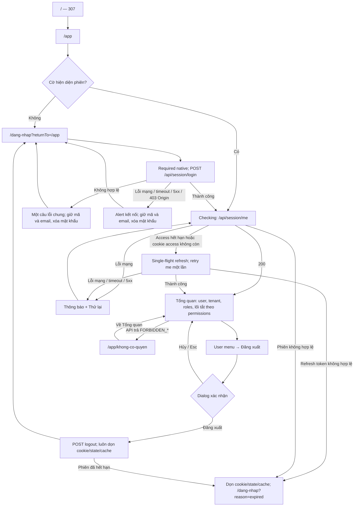

# Wireframe và user flow — frontend foundation POSE CRM

Ngày: **12/10/2026** · Owner: **Huỳnh Minh Tài** · [Design system](design-system-v1.md).

**Trạng thái: Tài đã duyệt tiếp tục Phase 2–5b ngày 12/10/2026**, kèm điều chỉnh topbar/icon và điểm dừng nếu font thật lệch rõ. `[Tên]`, `[Tổ chức]`, `[Mã]` biểu diễn dữ liệu session thực tế, không phải credentials hay dữ liệu demo.

**Sau scaffold:** đã dừng và báo khác biệt glyph Poppins/fallback; Tài chọn **Be Vietnam Pro làm font chính**. Kiểm lại next/font ở bốn weight, tất cả glyph dùng Be Vietnam Pro và không còn trộn font. Đã triển khai Phase 3–5 và kiểm tra Phase 5b; cấu trúc, flow và các chỉnh sửa topbar/icon giữ nguyên. [Ảnh mới](../../testing/assets/frontend-foundation-dot1-2026-10-12/be-font-700.png) · [Evidence](../../testing/frontend-foundation-dot1-2026-10-12.md). Kết quả responsive, mô phỏng và zoom native 200/400% ở mục 9.

## 1. Route và flow

| Route | Hành vi |
|---|---|
| `/` | Redirect tạm thời 307 tới `/app` |
| `/dang-nhap` | Form ba trường; có phiên hợp lệ thì `/app` |
| `/app` | Bootstrap phiên, app shell và Tổng quan chung |
| `/app/khong-co-quyen` | Giải thích 403, link Về Tổng quan |
| Route không tồn tại | `not-found`, link về `/app` |
| Lỗi render | Error boundary, thông báo chung và Thử lại |

`html lang="vi"`; mọi trang `/app` có metadata robots noindex. Chỉ Tổng quan có route menu đã triển khai trong đợt 1.



Login thành công mặc định tới `/app`; có `returnTo` hợp lệ thì tới đường dẫn đó theo mục 5.1. Đợt 1 không có dashboard riêng theo role. `returnTo` phải cùng origin, bắt đầu `/`, không `//`; loại backslash, ký tự điều khiển và các biến thể URL có thể đổi origin; không cho quay lại login/API gây vòng lặp.

**Sửa review 13/10:** lỗi mạng/timeout/5xx ở me hoặc refresh giữ phiên, cookie và cache; hiện “Không thể kết nối” + Thử lại, không navigate hay tự retry POST refresh. Chỉ lỗi xác thực phiên chắc chắn mới xử lý hết phiên. Login 400/401 giữ câu lỗi tài khoản chung; lỗi kết nối/backend/403 Origin dùng “Không thể kết nối. Vui lòng thử lại.”. [Evidence bổ sung](../../testing/frontend-foundation-review-2026-10-13.md).

### Session/BFF và quyết định bổ sung đã được Tài xác nhận

Ngày 12/10, Tài chọn **thêm cookie HttpOnly làm cờ hiện diện phiên, Path `/`** để middleware chuyển hướng sớm. Lý do: hai cookie token với Path `/api` và `/api/session` không được gửi tới `/app`. [Quy tắc Path của cookie](https://developer.mozilla.org/en-US/docs/Web/HTTP/Reference/Headers/Set-Cookie).

| Cookie | Nội dung | Path | Lifetime / thuộc tính |
|---|---|---|---|
| `pose_at` | Access token, chỉ server đọc | `/api` | `expiresIn`, HttpOnly, SameSite Strict, Secure ở production |
| `pose_rt` | Refresh token, chỉ server đọc | `/api/session` | 7 ngày theo D3; hạn phiên thực sự do backend quyết định |
| `pose_session_present` | Cờ hằng `1`; không có token, user hay permission | `/` | HttpOnly, SameSite Strict, Secure ở production; lifetime tối đa 7 ngày |

Login/refresh đặt cờ; logout và xử lý hết phiên xóa **cả ba** cookie đúng Path. Cờ có thể cũ/giả nên chỉ cho phép bootstrap, không chứng minh authenticated; vào login có cờ vẫn phải gọi me trước khi chuyển `/app`. Root `/` vẫn trả 307 `/app` trước khi guard `/app` chạy.

Route Handlers login/refresh chỉ trả user; me ghép `/auth/me` và `/organization` thành `{ user, organization: { id, code, name } }`. Không có token trong response client, browser storage, log hay evidence. Mutations kiểm `Origin` cùng origin; chỉ khi thiếu Origin mới nhận `Sec-Fetch-Site: same-origin`; không nhận `same-site`, `null` hoặc request thiếu cả hai. Proxy backend whitelist method/header/path, không forward cookie hay Authorization do client cung cấp, không proxy lại `/auth/*`, không tự refresh.

Refresh: Promise dùng chung trong tab; Web Lock `pose-session-refresh` giữa các tab. Sau nhận lock, kiểm me trực tiếp để tận dụng phiên đã được tab khác refresh; cần refresh mới thì gọi BFF, retry request gốc **một lần**. Fallback không Web Locks dùng single-flight trong tab và dedupe BFF theo SHA-256 refresh token (~10 giây, RAM cùng process); không retry POST refresh khi kết quả mạng không chắc chắn. Nhiều process cần điều phối dùng chung ở đợt triển khai hosting sau; không tuyên bố in-memory bảo vệ đa instance. [Web Locks API](https://developer.mozilla.org/en-US/docs/Web/API/Web_Locks_API).

Cookie `pose_at` hết Max-Age sẽ biến mất trước khi backend thấy JWT hết hạn. Để đạt kịch bản Phase 5 xóa access cookie, BFF me/proxy nhận thiếu access có thể trả `401 AUTH_TOKEN_EXPIRED` với error shape thống nhất để wrapper thử refresh một lần. Token vẫn có nhưng sai/thu hồi giữ `AUTH_INVALID_TOKEN`; không chữa revoked session bằng refresh. Thiếu refresh hoặc refresh lỗi thì logout cleanup, cancel queries, xóa toàn bộ Query cache và state, tới login hết phiên. Backend không cần sửa.

“Middleware” trong prompt là vai trò guard sớm. Khi scaffold bản stable Next.js 16+, đặt tại `src/proxy.ts` theo tên convention hiện hành; khác với `src/app/api/backend/[...path]/route.ts` là BFF proxy API. Chốt version tương thích ở Phase 2. [Convention chính thức](https://nextjs.org/docs/app/api-reference/file-conventions/proxy).

## 2. Login

### Desktop 1440 và tablet 768

```text
┌───────────────────────────────────┬────────────────────────────────────────────┐
│ Panel navy · POSE CRM              │ Form trên surface sáng · max 448           │
│ H2 Làm việc cùng dữ liệu khách hàng│ H1 Đăng nhập POSE CRM                       │
│ • Kết nối hoạt động bán hàng       │ Dùng tài khoản do quản trị viên cung cấp.  │
│ • Tiếp nối quá trình chăm sóc      │ [Thông báo hết phiên / alert lỗi nếu có]   │
│ • Dữ liệu trong phạm vi được giao  │ Mã tổ chức *                               │
│                                   │ [_______________________________]          │
│                                   │ Mã do quản trị viên cung cấp                │
│                                   │ Email * [_______________________]           │
│                                   │ Mật khẩu * [_______________] [Hiện]         │
│                                   │ [             Đăng nhập           ]         │
└───────────────────────────────────┴────────────────────────────────────────────┘
```

1440: panel/form chia đôi, gutter 32. 768: panel khoảng 40%, form phần còn lại, gutter 24; form co theo không gian, không fixed width. DOM đặt H1/form trước phần giới thiệu H2; CSS đưa panel sang trái, panel không có controls nên không đảo thứ tự Tab.

### Mobile 375 (và reflow 320)

```text
┌────────────────────────────────────┐
│ POSE CRM                           │
│ H1 Đăng nhập POSE CRM               │
│ Dùng tài khoản được cấp.            │
│ [Thông báo hết phiên / alert]       │
│ Mã tổ chức *                       │
│ [_______________________________]  │
│ Mã do quản trị viên cung cấp        │
│ Email *                            │
│ [_______________________________]  │
│ Mật khẩu *                         │
│ [______________________] [Hiện]    │
│ [          Đăng nhập            ]  │
└────────────────────────────────────┘
```

Dưới 768 ẩn panel bằng CSS và khỏi accessibility tree, chỉ còn form. Không header sticky ở login; bàn phím ảo và zoom vẫn cuộn được, không dùng chiều cao cứng.

Mã tổ chức `autocomplete="organization"`, `autocapitalize="characters"`; email `type="email"`, `autocomplete="username"`; mật khẩu `autocomplete="current-password"`. Mọi input có label, `required`; không `novalidate` hay chặn paste. Toggle `type="button"`, `aria-pressed`, `aria-controls`, nhãn Hiện/Ẩn mật khẩu.

| Trạng thái | Nội dung / focus |
|---|---|
| Trống hoặc email sai định dạng | Validation native; không gửi request |
| Đang gửi | Nút “Đang đăng nhập…”; khóa submit bằng state và guard đồng bộ |
| Lỗi xác thực | Alert duy nhất “Mã tổ chức, email hoặc mật khẩu không đúng.”; giữ mã/email, xóa mật khẩu, không cướp focus |
| `reason=expired` | “Phiên làm việc đã hết hạn. Vui lòng đăng nhập lại.” |
| Lỗi mạng | “Không thể kết nối. Vui lòng thử lại.” + Thử lại; không diễn giải là sai tài khoản |

## 3. App shell và Tổng quan

### Desktop 1440

```text
┌───────────────────┬─────────────────────────────────────────────────────────────┐
│ POSE     [Gọn]    │ header sáng: tên trang       [Tổ chức · Mã] [Avatar Tên ▾]  │
│                   │ Breadcrumb: Ứng dụng / Tổng quan                             │
│ nav Chính         ├─────────────────────────────────────────────────────────────┤
│ CHUNG             │ main#noi-dung · nền canvas · gutter 32                       │
│ [⌂ Tổng quan]     │ H1 Tổng quan                                                 │
│ active navy-blue  │ Chào [Tên], đây là không gian làm việc của bạn.              │
│                   │ dl: Tổ chức [Tên · Mã] | Vai trò [badge wrap]                │
│                   │                                                             │
│                   │ H2 Lối tắt                                                   │
│                   │ ul → li: [icon · H3 mục A] [icon · H3 mục B] [H3 mục C]      │
│                   │         Sẽ có ở giai đoạn sau · thẻ tĩnh                     │
│                   │         Các hàng tiếp theo theo permissions                 │
│                   │                                                             │
│ [Avatar Tên]      │ Nếu không có lối tắt: nội dung empty dưới H2                 │
│ Vai trò hiện tại  │                                                             │
└───────────────────┴─────────────────────────────────────────────────────────────┘
```

Sidebar rộng 256, cố định; user card ở đáy, không chứa thêm menu cạnh tranh với UserMenu topbar. Nút thu gọn giữ focus, `aria-expanded`/`aria-controls`; icon-only có tên và tooltip cả hover/focus, Esc dismiss tooltip. Chỉ nhóm Chung và Tổng quan xuất hiện: nhóm không có mục đã triển khai được ẩn. Breadcrumb dùng `nav` riêng + `ol`; tên trang ở header là text, không thêm H1.

Lối tắt chỉ gồm mục chức năng có permission, không lặp lại Tổng quan. Desktop ba cột, tablet hai, mobile một; thẻ surface có vùng icon pastel, viền mảnh, nội dung vừa đủ. Mục `implemented: false` là `<li><article><h3>…</h3>…</article></li>`, không link/button disabled, không Tab stop giả. Các role khác nhau tạo tập thẻ khác nhau từ permissions thật.

### Tablet 768

```text
┌───────┬───────────────────────────────────────────────────────────┐
│POSE   │ header: tên trang + breadcrumb         [User ▾]            │
│[Mở]   │ [Tổ chức · Mã] — có thể xuống hàng                       │
│[⌂]    ├───────────────────────────────────────────────────────────┤
│       │ H1 Tổng quan · chào [Tên] · tenant · role wrap             │
│       │ H2 Lối tắt                                                │
│       │ [H3 mục A + giai đoạn sau] [H3 mục B + giai đoạn sau]      │
│[AV]   │ Các hàng tiếp theo hoặc empty                             │
└───────┴───────────────────────────────────────────────────────────┘
```

Sidebar mặc định 80px ở 768–1023; cho mở rộng khi cần, content tự co/reflow. Mục Tổng quan và user vẫn có accessible name. Đổi breakpoint không lấy focus khỏi control đang dùng; tránh reset state thu gọn ở mọi re-render.

### Mobile 375

```text
┌────────────────────────────────────┐
│ sticky 56–64 [Menu] POSE [User ▾]   │
│ trong luồng: tên trang · breadcrumb│
│ trong luồng: [Tổ chức · Mã]         │
├────────────────────────────────────┤
│ main · gutter 16                   │
│ H1 Tổng quan                       │
│ Chào [Tên]                         │
│ Tổ chức · mã · role wrap           │
│ H2 Lối tắt                         │
│ [icon · H3 mục A]                  │
│ [Sẽ có ở giai đoạn sau]            │
│ [icon · H3 mục B]                  │
│ [Sẽ có ở giai đoạn sau]            │
└────────────────────────────────────┘

Drawer mở:
┌──────────────────────────┬─────────┐
│ H2 Điều hướng    [Đóng]   │ overlay │
│ POSE                     │ inert   │
│ nav Chính / CHUNG        │         │
│ [⌂ Tổng quan]            │         │
│                          │         │
│ [Avatar Tên + vai trò]   │         │
└──────────────────────────┴─────────┘
```

Drawer theo modal dialog: focus vào Đóng khi mở, Tab/Shift+Tab không thoát, Esc/Đóng/overlay đóng và trả focus nút Menu. Sidebar desktop ẩn khỏi cây accessibility trên mobile; chỉ một nav chính có thể truy cập. Khóa cuộn nền; nội dung drawer cuộn riêng khi thấp. Mobile chỉ hàng Menu · POSE · User sticky; breadcrumb và tenant trong luồng. Desktop hàng chính 64–72px và breadcrumb khi cần. Đo chiều cao sticky thực tế cho scroll-padding; bỏ sticky ở viewport cao ≤500px hoặc khi hàng chiếm quá nhiều chiều cao sau zoom. Kiểm focus tại 320px và zoom 200/400%.

Role hiển thị: ADMIN “Quản trị hệ thống”; MANAGER “Quản lý”; SALES_REP “Nhân viên kinh doanh”; CUSTOMER_CARE “Nhân viên chăm sóc khách hàng”; DATA_STAFF “Nhân viên dữ liệu”. Role chỉ dùng trình bày. `can(permission | permission[])` dùng permissions từ me; array là any-of.

## 4. Cấu hình menu và truy vết UC

Phase 4 tạo `src/config/navigation.ts`; mọi mục gồm label, route dự kiến, icon, permissions any-of, mã UC, implemented. Route dưới đây là **dự kiến**, không tạo page hay link khi chưa implemented.

| Nhóm / nhãn | Route | Heroicon | Permission any-of | UC |
|---|---|---|---|---|
| Chung / Tổng quan | `/app` | HomeIcon | Authenticated | — |
| Bán hàng / Sản phẩm & dịch vụ | `/app/san-pham-dich-vu` | CubeIcon | offering.manage | 03 |
| Phân công sản phẩm | `/app/phan-cong-san-pham` | UserPlusIcon | sales_assignment.manage | 04 |
| Lead | `/app/lead` | FunnelIcon | lead.read | 09 |
| Khách hàng | `/app/khach-hang` | UsersIcon | customer.read | 10 |
| Cơ hội bán hàng | `/app/co-hoi-ban-hang` | BriefcaseIcon | opportunity.read | 12 |
| Tương tác | `/app/tuong-tac` | ChatBubbleLeftRightIcon | interaction.read | 13 |
| Nhiệm vụ | `/app/nhiem-vu` | ClipboardDocumentCheckIcon | task.manage | 06/14/17 |
| Bàn giao khách hàng | `/app/ban-giao-khach-hang` | ArrowsRightLeftIcon | handover.request, handover.approve | 11 |
| Chăm sóc / Hồ sơ khách hàng 360 | `/app/khach-hang-360` | IdentificationIcon | customer_360.read | 15 |
| Yêu cầu hỗ trợ | `/app/yeu-cau-ho-tro` | LifebuoyIcon | support_request.manage, support_request.escalation.handle | 08/16 |
| Dữ liệu / Nhập dữ liệu | `/app/nhap-du-lieu` | ArrowUpTrayIcon | import.prepare, import.approve | 18–21 |
| Báo cáo | `/app/bao-cao` | ChartBarIcon | dashboard.read | — |
| Quản trị / Người dùng | `/app/nguoi-dung` | UserCircleIcon | identity.user.manage | — |
| Nhóm | `/app/nhom` | UserGroupIcon | organization.team.manage | — |
| Vai trò & quyền | `/app/vai-tro-quyen` | KeyIcon | identity.role.manage | — |
| Nhật ký hệ thống | `/app/nhat-ky-he-thong` | DocumentMagnifyingGlassIcon | audit.read | — |

Chỉ Tổng quan `implemented: true`; 16 mục khác `false`. Sidebar lọc cả implemented và permission; lối tắt lọc permission nhưng giữ mục chưa triển khai dưới dạng tĩnh. UC-01/02 là login/logout ngoài menu. UC-05 là thao tác phân công trong các module Lead/Khách hàng/Cơ hội; UC-07 là giao task kiểm tra dữ liệu liên quan Nhiệm vụ/Nhập dữ liệu. Hai UC này được truy vết ở đây, không tự tạo thêm menu/permission vượt danh sách prompt. “—” là chức năng nền tảng/SRS không có mã riêng trong bảng UC-01–21 đã đọc.

## 5. User menu và dialog đăng xuất

```text
Topbar: [Avatar · Tên · vai trò ▾] → menu [Đăng xuất]

┌────────────────────────────────────────┐
│ H2 Đăng xuất                           │
│ Bạn có chắc chắn muốn đăng xuất?       │
│                                        │
│             [Hủy]      [Đăng xuất]      │
└────────────────────────────────────────┘
```

Menu button: `aria-haspopup="menu"`, `aria-expanded`, `aria-controls`; Enter/Space/ArrowDown mở vào menuitem, ArrowUp/Down và Home/End điều hướng; Esc trả trigger, Tab đóng và đi tiếp đúng thứ tự. Chọn Đăng xuất đóng menu rồi mở modal. Modal `aria-labelledby`/`aria-describedby`, focus ban đầu Hủy, inert nền, focus trap, Esc = Hủy. Khi đóng trả focus về trigger hồ sơ vẫn tồn tại, không tới menuitem đã unmount.

Xác nhận: “Đang đăng xuất…” chặn gửi lặp; sau khi đã gửi không hủy thao tác backend bằng Esc. Luôn dọn cookie/cache/state, về login; nếu backend báo phiên hết hạn dùng `reason=expired`. Dialog tên H2 nằm sau H1 trang hiện tại; không tạo H1 thứ hai.

## 6. Trang trạng thái

```text
403 trong app shell                  404 ngoài shell
┌───────────────────────────────┐    ┌───────────────────────────────┐
│ H1 Bạn không có quyền truy cập │    │ POSE CRM                      │
│ Bạn chưa được cấp quyền cho   │    │ H1 Không tìm thấy trang       │
│ nội dung này.                 │    │ Trang không tồn tại hoặc đã  │
│ [Về Tổng quan]                │    │ được chuyển sang địa chỉ khác.│
└───────────────────────────────┘    │ [Về Tổng quan]                │
                                     └───────────────────────────────┘
```

Checking thay toàn bộ shell bằng skeleton có `aria-busy="true"`, nhãn “Đang kiểm tra phiên đăng nhập”; chưa render tenant/user cũ. Lỗi mạng bootstrap giữ thông báo + Thử lại, không coi là unauthenticated. Empty dưới H2 Lối tắt: “Bạn chưa có lối tắt được cấp quyền. Các chức năng sẽ hiển thị khi được quản trị viên cấp quyền.” Error boundary: H1 “Đã có lỗi xảy ra”, nội dung chung, Thử lại; không stack trace. Không tự chuyển focus chỉ vì state render lại.

## 7. Landmark và heading

| Trang / trạng thái | Cây ngữ nghĩa |
|---|---|
| Login | `main#noi-dung` → H1 Đăng nhập POSE CRM → `form` với label/input/helper/alert; phần giới thiệu `aside` → H2 (ẩn dưới 768) |
| Tổng quan | SkipLink → `aside` sidebar → `nav[Điều hướng chính]` + user card; `header` → text tên trang/UserMenu; hàng trong luồng → `nav[Breadcrumb] > ol` và TenantBadge; `main#noi-dung` → H1 Tổng quan → `dl` tenant/role → `section` H2 Lối tắt → `ul/li/article` H3 từng mục |
| 403 | Shell như trên; `main#noi-dung` → H1 Bạn không có quyền truy cập → giải thích → link Về Tổng quan |
| 404 | `main#noi-dung` → text Lỗi 404 → H1 Không tìm thấy trang → giải thích/link |
| Checking / lỗi bootstrap | `main#noi-dung` → H1 ẩn “Đang kiểm tra phiên đăng nhập” → vùng busy hoặc alert + Thử lại |
| Error boundary trong app | Shell giữ `main`; nội dung thay bằng H1 Đã có lỗi xảy ra → text/nút reset; không lồng main |
| Error root | `html[lang=vi] > body > main` → H1 Đã có lỗi xảy ra → text/nút thử lại |
| Drawer đang mở | `dialog[Điều hướng]` → H2 Điều hướng → nav chính; phần nền inert |
| Dialog đăng xuất | `dialog` → H2 Đăng xuất → đoạn mô tả → Hủy/Đăng xuất; trang nền đã có H1 |

Tên nhóm nav là text, không thêm heading nhảy cấp. SkipLink “Bỏ qua tới nội dung chính” hiện khi focus, tới `main#noi-dung` có thể nhận focus. Sidebar/menu chỉ dùng link cho route thật; drawer cũng dùng cùng navigation config.

## 8. Điểm kiểm sau khi được duyệt

Phase 2–5b thực hiện lần lượt scaffold → component/RTL → BFF/session → trang/tích hợp backend thật → nghiệm thu. Ngay sau scaffold kiểm chuỗi glyph thật dùng next/font ở H1 login, label, nút/sidebar, bốn độ đậm; lệch baseline/cỡ chữ rõ trong cùng từ thì dừng và báo ảnh, không tự đổi font. Bắt buộc bàn phím, 320/768/1024/1440, zoom 200/400%, tên/email dài, reduced motion; cookie/path/CSRF, concurrent refresh/retry, permission và năm role thật. [Evidence](../../testing/frontend-foundation-dot1-2026-10-12.md) phân biệt phép đo đã chạy với kiểm dự kiến.

## 9. Khung đã triển khai

Luồng và route ở mục 1 đã kiểm bằng Next.js production, backend thật và PostgreSQL cô lập. Login giữ native validation, lỗi chung và xóa mật khẩu; cookie cờ chỉ phục vụ proxy UX. Next.js 16 dùng `src/proxy.ts` cho chức năng trước đây gọi middleware. Quyền luôn lấy từ me và backend.

Desktop 1440: sidebar 256px + hàng header 72px; tablet 768: sidebar 80px; mobile 320/375: drawer và header 64px. Breadcrumb/TenantBadge đều trong luồng ở cả ba khung. Drawer và dialog dùng native dialog/showModal, background inert; Esc/Hủy và trả focus đã kiểm bằng bàn phím thật. Khi topbar cao hơn 1/4 viewport hoặc viewport ≤500px, header chuyển relative; scroll-padding dùng chiều cao thật + 16px.

Menu khai báo 17 mục, chỉ Tổng quan là link triển khai. Lối tắt theo permission: ADMIN 16, MANAGER 14, SALES_REP 8, CUSTOMER_CARE 6, DATA_STAFF 8 trong dữ liệu đã restore; số này mô tả kiểm thử, không xuất thành KPI trên UI. Các thẻ tương lai là nội dung tĩnh có heading, không phải link.

[Login](../../testing/assets/frontend-foundation-dot1-2026-10-12/login-desktop.png) · [Shell desktop](../../testing/assets/frontend-foundation-dot1-2026-10-12/overview-width-1440.png) · [Tablet](../../testing/assets/frontend-foundation-dot1-2026-10-12/overview-width-768.png) · [Mobile](../../testing/assets/frontend-foundation-dot1-2026-10-12/overview-width-320.png) · [Drawer](../../testing/assets/frontend-foundation-dot1-2026-10-12/mobile-drawer.png) · [Dialog](../../testing/assets/frontend-foundation-dot1-2026-10-12/logout-dialog.png) · [403](../../testing/assets/frontend-foundation-dot1-2026-10-12/forbidden.png) · [404](../../testing/assets/frontend-foundation-dot1-2026-10-12/not-found.png).

Đã kiểm 320/768/1024/1440, nội dung dài, checking/network/empty/error, viewport tương đương và zoom native Chrome 200/400%. Native zoom dùng cấu hình profile riêng, không device metrics hay CSS zoom; login/shell/drawer/dialog vẫn dùng được ở viewport thực tế 629×351 và 314×175. [Evidence native](../../testing/assets/frontend-foundation-dot1-2026-10-12/native-zoom-acceptance.json). Screen reader còn chưa kiểm; không tuyên bố đạt toàn bộ WCAG.
