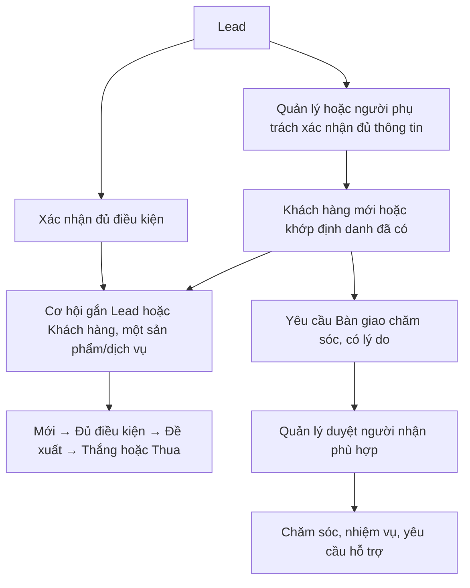

# Wireframe trang giới thiệu POSE CRM v1

Ngày: **13/10/2026** · Owner: **Huỳnh Minh Tài** · **Tài đã duyệt Phase B–C và chỉnh sửa nội dung**.

Đọc cùng [bản chữ và nguồn](landing-content-v1.md), [design system v1](design-system-v1.md) và [review đợt 1](../../testing/frontend-foundation-review-2026-10-13.md). Đây là khung và kế hoạch kiểm, chưa có trang landing chạy thật. Chưa thay redirect /, thêm ảnh, sửa CSS login hoặc logic phiên.

## 1. Mục tiêu và nhịp trang

Người xem hiểu POSE là đồ án CRM đa ngành, phạm vi thiết kế và trách nhiệm từng vai trò, rồi dùng tài khoản được cấp để đăng nhập. Một hành động chính: **Đăng nhập → /dang-nhap**. Trang / công khai không đọc session hoặc gọi API; nội dung chính có ngay trong HTML tĩnh.

Thứ tự DOM: SkipLink → header → main (S1–S9) → footer. Nội dung dài được chia theo mục đích đọc; không giấu thông tin chính trong carousel, tab hay animation. FAQ là details/summary. Sections xen kẽ surface/canvas; hero navy. Không dùng Super Admin cho trang giới thiệu.

| Section | Nền / cấu trúc | Vai trò |
|---|---|---|
| Header | Surface, viền mảnh; wordmark, anchor, Đăng nhập | Định hướng, thao tác chính |
| S1 Hero | Navy; chữ trước, figure sau; hai cột từ 1024 | Định nghĩa + phạm vi đồ án + ảnh thật |
| S2 Năng lực | Surface; ul năm thẻ ngắn, H3 và icon | Quét năm nhóm thiết kế |
| S3 Khó khăn | Canvas; ul năm mục, H3 + vấn đề/hướng xử lý | Nối nhu cầu với rule có nguồn |
| S4 Quy trình | Surface; ol sáu bước | Giải thích phối hợp bán hàng/chăm sóc |
| S5 Vai trò | Canvas; ul năm thẻ, mỗi thẻ ul ba ý | Xác định trách nhiệm và scope |
| S6 Ngành | Surface; ul sáu nhãn và chú thích demo | Minh họa mô hình đa ngành |
| S7 Phân quyền | Canvas; dl sáu cặp nhãn/giải thích | Quy tắc dữ liệu, không huy hiệu chứng nhận |
| S8 FAQ | Surface; tám details/summary | Trả lời trực tiếp, khớp JSON-LD |
| S9 CTA | Canvas; H2, một câu, link Đăng nhập | Kết thúc bằng đường đi thật |
| Footer | Surface; tên, mô tả đồ án, nav phụ, time | Nguồn gốc và ngày cập nhật |

## 2. Nguồn bố cục và tra cứu skill

Đã xem ảnh A/B/C/D đính kèm; hai ảnh CloudSALES cùng thuộc C (lưới khó khăn và trình bày tính năng). Đã đọc cấu trúc [CloudGO](https://cloudgo.vn/) và [CloudSALES](https://cloudgo.vn/cloudsales-giai-phap-crm-quan-ly-ban-hang-da-kenh) ngày 13/10. Chỉ dùng nhịp bố cục. Chữ ở [content v1](landing-content-v1.md) được viết từ nguồn POSE.

| Nguồn tham chiếu | Phần áp dụng / vì sao | Phần loại bỏ |
|---|---|---|
| A — Duralux | Hero chữ/ảnh hai cột, danh sách điểm chính; giúp nhìn sản phẩm cạnh định nghĩa | Logo, số liệu, hình dashboard của mẫu, gradient và badge công nghệ |
| B — CloudGO hero | Định nghĩa → mô tả → CTA; nhóm vấn đề bên phải được chuyển thành S2 dải năng lực để hero dành chỗ ảnh thật | Form email/dùng thử, social/floating CTA, đồ họa thiết bị, chữ và mọi claim thương mại |
| C — CloudSALES | S3 mục khó khăn có lý do; S2/S5 thẻ có nội dung và heading rõ; dễ quét theo nhóm | H3 trước H1, nội dung chức năng ngoài nguồn, lời chào bán và bảng giá |
| D — Weihu | Icon nền pastel có nhãn; dùng lại token có sẵn để phân nhóm | Kanban, số tiến độ và avatar mẫu |
| Super Admin 3.2 | Chỉ ghi chú nguồn đợt 1; dành cho dashboard/module sau | Không đưa vào landing, không sửa UI đợt 1 |

Đã chạy Python bằng đường dẫn tuyệt đối; không --persist, không --force:

```powershell
& C:\Users\Dell\anaconda3\python.exe 'C:\Users\Dell\.codex\worktrees\pose-tai-auth\POSE\.agents\skills\ui-ux-pro-max\scripts\search.py' 'B2B SaaS landing hero features faq' --domain landing
& C:\Users\Dell\anaconda3\python.exe 'C:\Users\Dell\.codex\worktrees\pose-tai-auth\POSE\.agents\skills\ui-ux-pro-max\scripts\search.py' 'B2B product hero features' --domain landing
& C:\Users\Dell\anaconda3\python.exe 'C:\Users\Dell\.codex\worktrees\pose-tai-auth\POSE\.agents\skills\ui-ux-pro-max\scripts\search.py' 'B2B CRM landing static accessible' --design-system -p 'POSE CRM'
```

Truy vấn yêu cầu đầu tiên trả FAQ/Documentation, Pricing-Focused, AI Personalization: chỉ nhận phần FAQ và chữ dễ đọc; pricing/AI không phù hợp. Đã thu hẹp **một lần**, nhận Product Demo + Features và Hero + Features + CTA. Áp dụng ảnh sản phẩm tĩnh, giải thích năng lực, CTA đầu/cuối trang; loại video/interactive demo, màu gợi ý và parallax.

Tra design-system cho hướng trang mới trả Accessible & Ethical và Trust & Authority + Conversion. Chỉ nhận semantic, bàn phím, focus, ảnh giữ kích thước và body 16px. Loại proof/logo/chứng nhận/case study, form, CTA thương mại, Roboto và palette mới; L2/L3 của Tài ưu tiên. Dùng **Be Vietnam Pro và token v1**, không tạo design system khác. Reference pro-rules thiên native; target web ưu tiên 44 CSS px và kiểm ngưỡng WCAG 24 CSS px, không sao chép pt/dp hoặc dark mode.

## 3. Khung desktop 1440

```text
┌───────────────────────────────────────────────────────────────────────────────┐
│ POSE CRM     Năng lực · Quy trình · Vai trò · Bảo mật · Câu hỏi    [Đăng nhập] │
│ header surface, hàng 72; sticky khi viewport đủ cao                           │
├───────────────────────────────────────────────────────────────────────────────┤
│ S1 navy                                                                       │
│ ┌───────────────────────────────────┬───────────────────────────────────────┐ │
│ │ Đồ án CRM đa ngành                │ figure: ảnh Tổng quan thật, Quản lý  │ │
│ │ H1 POSE CRM — quản lý bán hàng…    │ crop vùng lối tắt, giữ nhãn giai đoạn│ │
│ │ Định nghĩa + phạm vi thiết kế     │ sau; không email/mã/tên tài khoản    │ │
│ │ [Đăng nhập] + tài khoản được cấp │ figcaption giải thích trạng thái    │ │
│ │ Ghi chú màn hình nghiệp vụ sau   │                                      │ │
│ └───────────────────────────────────┴───────────────────────────────────────┘ │
├───────────────────────────────────────────────────────────────────────────────┤
│ S2 H2 + trả lời trực tiếp     [H3] [H3] [H3] [H3] [H3]                        │
├───────────────────────────────────────────────────────────────────────────────┤
│ S3 H2 + trả lời trực tiếp     [vấn đề / rule] × 5, lưới ba cột               │
├───────────────────────────────────────────────────────────────────────────────┤
│ S4 H2 + trả lời trực tiếp     ol 1–6, bước và mô tả rõ                         │
├───────────────────────────────────────────────────────────────────────────────┤
│ S5 H2 + trả lời trực tiếp     [vai trò + ul] [vai trò + ul] [vai trò + ul]     │
│                              [vai trò + ul] [vai trò + ul]                    │
├───────────────────────────────────────────────────────────────────────────────┤
│ S6 H2 + trả lời trực tiếp     [ngành + icon] × 6; chú thích dữ liệu demo       │
├───────────────────────────────────────────────────────────────────────────────┤
│ S7 H2 + trả lời trực tiếp     dl: [nhãn + giải thích] × 6, hai cột             │
├───────────────────────────────────────────────────────────────────────────────┤
│ S8 H2 + trả lời trực tiếp     details/summary × 8, cột đọc vừa phải            │
├───────────────────────────────────────────────────────────────────────────────┤
│ S9 H2 · một câu · [Đăng nhập]                                                  │
├───────────────────────────────────────────────────────────────────────────────┤
│ POSE CRM · mô tả đồ án     Đăng nhập · Câu hỏi     Cập nhật lần cuối: <time>   │
└───────────────────────────────────────────────────────────────────────────────┘
```

Nội dung căn giữa với giới hạn chiều rộng theo token measure hiện có; hero chữ không quá measure-form 448px ở desktop. Gutter 32, gap 24/32; section padding 48/64 theo scale v1. Hero H1 dùng font-title 32px/weight 700, mobile 24px; không tự mở rộng scale font. H2 20px, H3/body 16px; chữ phụ 14px khi phù hợp. Tỉ lệ hai cột hero khoảng 5:7; ảnh có khoảng riêng, không chồng lên chữ; khung ảnh viền 1px bằng border token, radius-card 12px, không shadow dày. Không ép chiều cao section hoặc thẻ để căn cho đẹp.

## 4. Khung tablet 768

```text
┌───────────────────────────────────────────────┐
│ POSE CRM                              [Menu] │ ← hàng sticky 64
├───────────────────────────────────────────────┤
│ Khi mở: nav anchor và Đăng nhập trong luồng    │
├───────────────────────────────────────────────┤
│ S1 navy                                       │
│ H1 → định nghĩa → CTA + phụ chú → phạm vi     │
│ figure sản phẩm + figcaption                  │
├───────────────────────────────────────────────┤
│ S2 H2 + đoạn      [năng lực] × 5, ba cột      │
│ S3 H2 + đoạn      [vấn đề / rule], hai cột    │
│ S4 H2 + đoạn      ol sáu bước                 │
│ S5 H2 + đoạn      [vai trò + ul], hai cột     │
│ S6 H2 + đoạn      [ngành], ba cột             │
│ S7 H2 + đoạn      dl, hai cột                 │
│ S8 H2 + đoạn      details/summary × 8         │
│ S9 H2 + đoạn + Đăng nhập                      │
├───────────────────────────────────────────────┤
│ Footer wrap, nav phụ, time                    │
└───────────────────────────────────────────────┘
```

Gutter 24, gap 16/24. Dùng disclosure dưới 1024 để năm anchor không chen vào header 768. Hero vẫn một cột. Đây là phương án đáp ứng tablet; dưới 768 chỉ hàng logo/menu sticky theo yêu cầu mobile. Các vùng nội dung và nav mở đều trong luồng.

## 5. Khung mobile 375, kiểm thêm 320

```text
┌─────────────────────────────────┐
│ POSE CRM                 [Menu] │ ← chỉ hàng này sticky 64
├─────────────────────────────────┤
│ Khi mở: Năng lực                │
│         Quy trình               │
│         Vai trò                 │
│         Bảo mật                 │
│         Câu hỏi                 │
│         [Đăng nhập]             │ ← nav trong luồng, không modal
├─────────────────────────────────┤
│ S1 H1                           │
│ Định nghĩa + phạm vi             │
│ [Đăng nhập]                      │
│ Tài khoản được cấp               │
│ Ghi chú đồ án                    │
│ figure ảnh + figcaption          │
├─────────────────────────────────┤
│ S2 H2 + đoạn → năm thẻ một cột  │
│ S3 H2 + đoạn → năm mục một cột  │
│ S4 H2 + đoạn → ol, trục dọc      │
│ S5 H2 + đoạn → năm role một cột │
│ S6 H2 + đoạn → danh sách ngành  │
│ S7 H2 + đoạn → dl một cột        │
│ S8 H2 + đoạn → tám disclosure   │
│ S9 H2 + đoạn + Đăng nhập         │
├─────────────────────────────────┤
│ Footer → nav phụ → time         │
└─────────────────────────────────┘
```

Gutter 16, gap 16; không dùng chiều rộng fixed hoặc chữ nowrap. Lưới năng lực: **1 cột dưới 640; 2 từ 640; 3 từ 768; 5 từ 1280**. Lưới vai trò: **1 dưới 768; 2 từ 768; 3 từ 1024**. Khó khăn 1/2/3; ngành 1/2/3 theo không gian. Mọi breakpoint là quyết định layout, không thay token màu/font. Kiểm 320/375/768/1024/1440 và zoom thật 200/400% trước nghiệm thu.

## 6. Landmark, heading và hành vi

```text
a SkipLink → main#noi-dung (có thể nhận focus)
header
  a wordmark → /
  nav[Điều hướng trang giới thiệu] > ul > li > a (desktop)
  MobileNavDisclosure (tablet/mobile): button + nav > ul > li > a
main#noi-dung
  section[aria-labelledby=hero-title]
    H1 POSE CRM — quản lý bán hàng và chăm sóc khách hàng đa ngành
    đoạn, CTA link, ghi chú; figure > image + figcaption
  section#nang-luc[aria-labelledby=capabilities-title]
    H2 Năm nhóm năng lực chính
    ul > li > article > H3 × 5 + đoạn
  section[aria-labelledby=problems-title]
    H2 Những khó khăn POSE CRM hướng tới
    ul > li > H3 × 5 + đoạn
  section#quy-trinh[aria-labelledby=process-title]
    H2 Quy trình bán hàng và chăm sóc trên POSE
    ol > li > H3 × 6 + đoạn
  section#vai-tro[aria-labelledby=roles-title]
    H2 Mỗi vai trò làm gì trên POSE
    ul > li > article > H3 × 5 + ul ba ý
  section[aria-labelledby=industries-title]
    H2 Một nền tảng cho nhiều ngành
    ul sáu ngành, chú thích demo
  section#bao-mat[aria-labelledby=trust-title]
    H2 Phân quyền và an toàn dữ liệu
    dl > dt/dd × 6
  section#cau-hoi[aria-labelledby=faq-title]
    H2 Câu hỏi thường gặp
    details > summary + p × 8 (summary không thêm H3)
  section[aria-labelledby=cta-title]
    H2 Vào không gian làm việc của tổ chức
    đoạn, a Đăng nhập
footer
  tên, mô tả đồ án; nav[Điều hướng cuối trang]; time[datetime]
```

Đúng một H1. Không dùng section không có heading; label dl, nav, wordmark và số thứ tự bước không phải heading. Tất cả H3 đầy đủ ở content v1. Desktop/mobile nav cùng nhãn, chỉ một bản hiện diện trong accessibility tree theo breakpoint; id của disclosure và aria-labelledby không trùng.

Mobile menu theo [APG disclosure](https://www.w3.org/WAI/ARIA/apg/patterns/disclosure/): button type=button, aria-expanded, aria-controls; Enter/Space bật/tắt, Tab theo luồng, Esc đóng và trả focus về nút. Không role=menu/menuitem, không trap focus hay inert nền. Bấm anchor đóng disclosure, để điều hướng native tới section; không giành lại focus về nút sau chọn anchor. FAQ native details/summary hỗ trợ Enter/Space, icon chevron aria-hidden; không thêm xử lý Esc không có trong disclosure FAQ native.

Desktop header 72px, mobile/tablet hàng đầu 64px. Nav mobile mở trong luồng, ngoài vùng sticky. Html scroll-padding-top = hàng sticky + space-4; dùng cùng kích thước token với CSS header, không cần thêm component client đo resize. Khi viewport cao ≤500px, bỏ sticky và chỉ giữ space-4 cho scroll-padding. Không đặt max-height cắt nội dung; nếu chữ lớn làm header vượt thiết kế, ưu tiên reflow và bỏ sticky, kiểm focus thực tế. Focus navy dùng focus-sidebar; CTA giữ primary/on-primary. Target ưu tiên 44×44 CSS px; link nhiều dòng tăng chiều cao tự nhiên.

## 7. Phân nhánh nghiệp vụ tránh hiểu sai



Sơ đồ phục vụ review nội dung, không phải widget trên landing. Không có mũi tên Thắng tự động tạo Khách hàng. Nguồn BR:45–53,80–83; DEC-01/05. Duyệt import có Quản lý hoặc Quản trị hệ thống theo DEC-02; nội dung public nêu một bước duyệt, không diễn giải chi tiết triển khai chưa có.

## 8. Ảnh sản phẩm và phần sửa login

Sau duyệt mới chạy backend/DB theo guard đã có và đăng nhập thật vai trò Quản lý ở desktop 1440. Chụp Tổng quan, **crop vùng lối tắt** để bỏ toàn bộ sidebar/user card, topbar/user menu, lời chào chứa danh tính và vùng tenant có mã tổ chức. Giữ thẻ và nhãn “Sẽ có ở giai đoạn sau”; không xóa nhãn để tạo cảm giác module đã triển khai. Kiểm pixel ảnh kết quả trước khi đưa public.

Lưu public/images/pose-crm-overview.webp ≤200 KB; bản OG tĩnh public/images/pose-crm-overview-og.webp 1200×630 từ cùng ảnh đã crop. Dùng khung surface và khoảng trống nếu cần để giữ nội dung, không dựng số liệu hoặc sửa UI trong ảnh. next/image có width/height thực tế, sizes theo layout, alt/figcaption ở content v1; hero priority, không carousel/video. OG cùng alt, không ảnh động. Chưa tạo hoặc commit ảnh trong Phase A.

Login chỉ sửa CSS trong scope form: alert phía trên form có margin-block-end space-4 (16px), kể cả trạng thái hết phiên/lỗi chung/lỗi kết nối; không đổi component Alert dùng ở chỗ khác hoặc logic submit/session. Chụp lại trạng thái lỗi khi mật khẩu đã xóa; ảnh evidence không dùng làm ảnh landing.

## 9. Kiến trúc SEO/AEO dự kiến

Page / là Server Component tĩnh, không cookies/searchParams/API; thay redirect tại page.tsx. Các component theo prompt trong components/landing; chỉ MobileNavDisclosure thêm use client. Tất cả nội dung có kiểu đặt content/landing.ts; FAQ HTML và JSON-LD cùng dữ liệu, source mapping giữ ở tài liệu này.

- SITE_URL server-only, mặc định http://127.0.0.1:3000; metadataBase/canonical/OG/robots/sitemap dùng chung origin. .env.example thêm SITE_URL cùng chú thích, không secret. Metadata chỉ của trang public; /app và login giữ noindex có sẵn.
- Title absolute **52 ký tự**, description **146 ký tự**, canonical /, index/follow, OG website vi_VN và ảnh tĩnh, Twitter summary_large_image. Nguồn: [Next.js Metadata](https://nextjs.org/docs/app/getting-started/metadata-and-og-images).
- Robots allow /, disallow /app, /api, /dang-nhap; sitemap chỉ / và lastModified lấy hằng contentUpdatedAt (2026-10-13), không Date.now. [Robots](https://nextjs.org/docs/app/api-reference/file-conventions/metadata/robots), [sitemap](https://nextjs.org/docs/app/api-reference/file-conventions/metadata/sitemap).
- Disallow quản lý crawl, không tự bảo đảm noindex. Đề xuất X-Robots-Tag: noindex, nofollow cho /api/:path* qua Next config headers; không đổi BFF/proxy/session. Kiểm response thật ở Phase C. Không tuyên bố đã loại URL khỏi chỉ mục bên ngoài khi chưa có domain/Search Console. [Google noindex](https://developers.google.com/search/docs/crawling-indexing/block-indexing).
- Một script JSON-LD chứa @graph: WebSite (name/url/inLanguage), SoftwareApplication (name, BusinessApplication, Web, vi, description đúng meta), FAQPage (Question/acceptedAnswer đúng tám FAQ). Các node có @id cùng SITE_URL. Không offers/review/aggregateRating. [WebSite](https://schema.org/WebSite), [SoftwareApplication](https://schema.org/SoftwareApplication), [FAQPage](https://schema.org/FAQPage).
- JSON.stringify rồi thay ký tự < bằng chuỗi escape Unicode `\u003c` (literal JavaScript trong hướng dẫn dùng `'\\u003c'`); kiểm JSON.parse và không có chuỗi đóng script. [Next.js JSON-LD](https://nextjs.org/docs/app/guides/json-ld). Không cài schema-dts hoặc thư viện serializer.

Kiểm nguồn ngày 13/10: URL Google FAQ trong prompt hiện chuyển hướng sang changelog; Google thông báo FAQ rich result không còn hiển thị từ **07/05/2026**, và gỡ tài liệu trong tháng 6. Vẫn giữ FAQPage schema.org theo yêu cầu để mô tả ngữ nghĩa; không hứa rich result, thứ hạng hay khả năng được AI trích dẫn. [Google Search updates](https://developers.google.com/search/updates#may-2026). Structured data phải phản ánh nội dung đọc được, không dữ liệu bịa. [Google policies](https://developers.google.com/search/docs/appearance/structured-data/sd-policies).

**Rủi ro hiệu năng có sẵn:** root layout đang bọc Providers/TanStack Query (layout.tsx:4,18; Providers.tsx:1–9). Server Component tĩnh vẫn có thể tải JS từ provider kế thừa. Tài duyệt trước: nếu Lighthouse mobile <90 do Providers, được chuyển Providers xuống app layout và login/phần client cần nó, giữ toàn bộ test cũ và hành vi session/logout/clear cache, ghi số đo trước/sau. Thay đổi khác ngoài phạm vi này vẫn phải hỏi. Không chuyển provider trước khi có bằng chứng đo.

## 10. Kế hoạch nghiệm thu sau duyệt

| Nhóm | Phép kiểm Phase B/C |
|---|---|
| Nội dung/semantic | RTL một H1, không nhảy cấp, mọi section có aria-labelledby; nav anchor/id hợp lệ; không chuỗi credentials/demo email; kiểm ảnh bằng mắt |
| FAQ/JSON-LD | Cùng tám câu/đáp án, parse được, escape <, không đóng script; đối chiếu schema.org thủ công |
| Disclosure | Tab/Shift+Tab/Enter/Space/Esc, expanded đúng, Esc trả focus; chọn anchor đúng vị trí, nav đóng không giành focus |
| SEO production | npm ci bản sao sạch → lint/typecheck/test/build; / ký hiệu ○; HTML curl có heading/meta/canonical/JSON-LD; robots/sitemap/API noindex đúng; /app chưa có phiên vẫn redirect/login |
| Responsive | 320/375/768/1024/1440, hero hai cột từ 1024, lưới đúng nhịp, không cuộn ngang, nội dung không bị cắt |
| Accessibility | Focus/SkipLink/anchor không bị header che, native FAQ, target, reduced motion, zoom thật 200/400%; đo computed contrast các cặp hero/surface/canvas/pastel; không chỉ dựa Lighthouse |
| Hiệu năng | next start, npx --yes lighthouse@<stable được xác minh lúc chạy>; ghi version, mobile và desktop P≥90/A≥95/BP≥95/SEO=100; ghi audit fail và nguyên nhân, không đổi mục tiêu |
| Validator ngoài | Rich Results/Schema Markup Validator qua URL public nếu có; localhost không truy cập từ ngoài thì ghi chưa kiểm, không deploy để vượt điều kiện |
| Evidence/Git | Summary và ảnh không secret; không full report môi trường; README SITE_URL/cách kiểm; commit theo ý, author fransico08, không push/Co-authored-by |

Phase A chỉ kiểm tài liệu, nguồn, độ dài metadata và liên kết; chưa chạy Lighthouse, browser, build hoặc sửa spacing login. Hai điểm nội dung ở [content mục 12](landing-content-v1.md#12-hai-cách-diễn-đạt-đã-được-tài-duyệt) đã được Tài duyệt. Bản chữ cập nhật trước code; S7/FAQ dùng chữ thông thường cho ghi chú chia sẻ, thay permission bằng quyền; hero/figcaption/ngày đặt cạnh nhau để cập nhật khi có module mới. API noindex qua config headers được duyệt, không đổi logic BFF/proxy/session.


## 11. Đối chiếu triển khai Phase B–C — 13/10/2026

Đã dựng đúng S1–S9, một H1, tám H2 và 21 H3; đủ banner/main/contentinfo. Desktop header đo 72px, mobile/tablet 64px, scroll-padding 88/80px; nav mobile mở trong luồng, không modal. Zoom native 200/400% bỏ sticky (CSS viewport 629×351 / 314×175), scroll-padding 16px. Reflow 320/375/768/1024/1440 không cuộn ngang; capability 5/3/1 và roles 3/2/1 ở các mốc đã kiểm, rule 2 cột capability từ 640px giữ theo kế hoạch.

Ảnh thật vai trò Quản lý tại desktop 1440: crop chỉ vùng lối tắt, không giữ tên/email/mã tổ chức. WebP 1105×741, 49.358 byte; OG 1200×630, 36.542 byte. Hero dùng width/height thật và preload (API thay priority đã deprecated từ Next 16); FAQ dùng details/summary, chỉ MobileNavDisclosure là component dự án mới có use client. Chữ scopeNote/productCaption/date cạnh nhau trong content; FAQ-06/JSON-LD cùng chuỗi dễ hiểu, không enum.

Root là trang tĩnh ○, không đọc session/gọi API. SITE_URL server mặc định 127.0.0.1:3000; API noindex qua config.headers, không đổi BFF/proxy/session. Theo duyệt Tài, đã chuyển Providers nguyên vẹn xuống app/login sau mobile 89 điểm; sau chuyển 92 điểm, JavaScript tải giảm 160.370 → 149.775 byte. Desktop 100; Accessibility 100, Best Practices 96, SEO 100 cả hai. Không đổi package, font, token màu. 78 test và clean npm ci/lint/typecheck/build đạt; backend thật chứng minh session/logout/retry giữ hành vi.

[Evidence chi tiết](../../testing/frontend-landing-dot2-2026-10-13.md) · [README/cách duy trì nội dung](../../../frontend/README.md).
