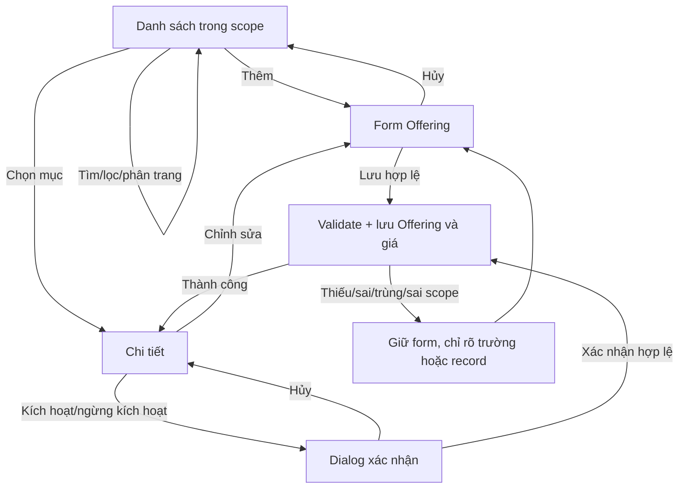
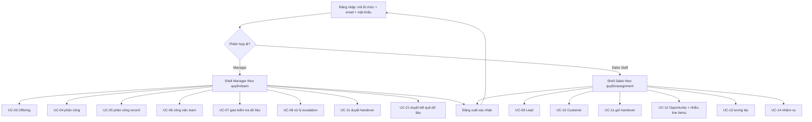
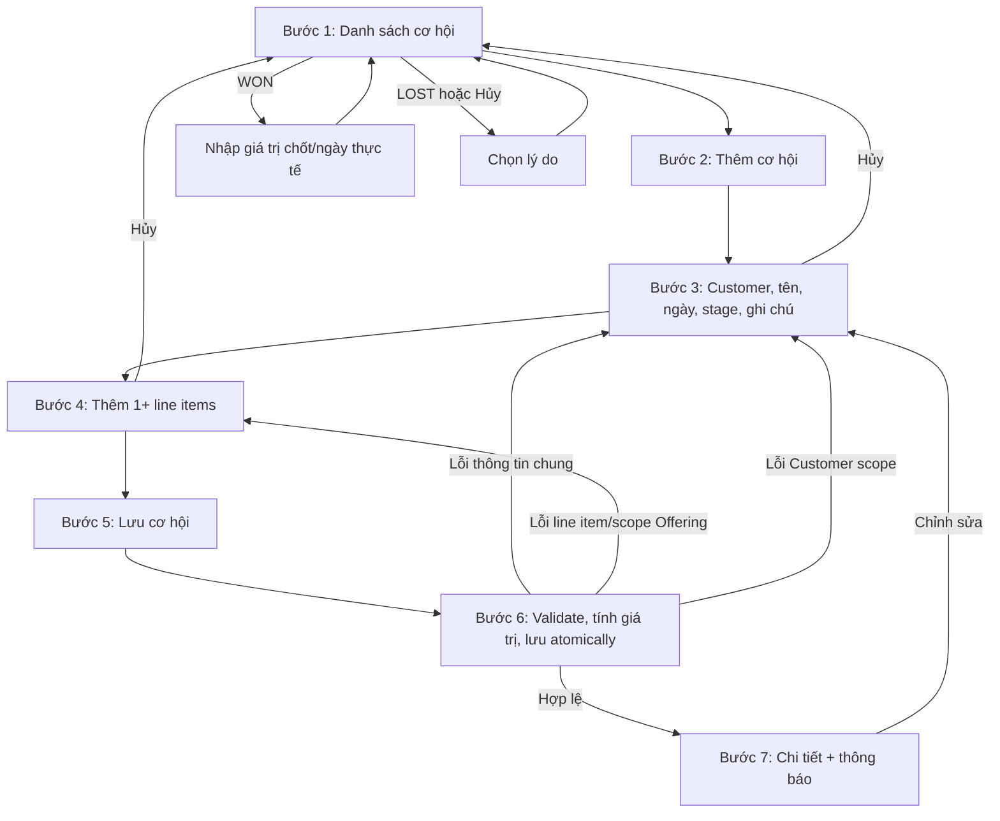

# Wireframe và luồng người dùng Sales và Manager

Ngày: 01/11/2026 · Nguồn nghiệp vụ: `C:\Users\WIN 11\Downloads\Task làm việc POSE.docx` bản cập nhật ngày 01/11/2026 · Phạm vi: UC-01 đến UC-14, UC-21 và điểm duyệt UC-11.

Tài liệu này chốt bố cục và hành vi cần có cho hai backlog wireframe/user flow. Đây là wireframe nghiệp vụ để review và truy vết, không phải màn hình triển khai của các module Sales/Manager ngoài Offering. Chỉ Offering (UC-03) được triển khai FE/BE/DB trong đợt này; các UC còn lại là thiết kế cho backlog sau.

## 1. Phạm vi và nguồn quyết định

- Word mới là nguồn yêu cầu cho các Use Case. Các luồng UC-12 dưới đây dùng phiên bản đã sửa: một cơ hội có một hoặc nhiều dòng sản phẩm/dịch vụ; giá trị dự kiến bằng tổng giá trị các dòng.
- Kế thừa app shell, Be Vietnam Pro, màu/spacing/component và trạng thái hiện có trong [design system v1](design-system-v1.md), [wireframe nền tảng](frontend-foundation-wireframe.md) và `frontend/src/components/`.
- Quyền, organization và team scope lấy từ backend; không nhận tenant/team scope từ URL để cấp quyền. Mục trong sidebar chỉ hiện theo permission; API vẫn phải kiểm quyền.
- Offering thuộc một team. Manager chỉ chọn và thao tác trên team do mình quản lý. Admin có quyền `offering.manage` có thể xử lý trong organization theo policy hiện có.
- UC-03 của Word yêu cầu Danh mục dù Class Diagram ghi tùy chọn. Wireframe và form triển khai theo UC-03: Danh mục là bắt buộc. Class Diagram đang chờ người dùng cập nhật; tài liệu đó không được sửa trong đợt này.
- Đặc tả UC-12 trong Word có `OpportunityLine`, nhưng code Opportunity không thuộc backlog Offering. Wireframe UC-12 thể hiện nhiều dòng để làm rõ yêu cầu mới; chưa thay Class Diagram.
- Trang đăng nhập hiện có thêm Mã tổ chức vì API login của repo xác thực bằng `(organizationCode, email)` trong tenant. Không bỏ trường này để khớp mô tả rút gọn của Word.

## 2. App shell và điều hướng theo quyền

### Wireframe shell desktop

```text
┌────────────────────┬──────────────────────────────────────────────────────────┐
│ POSE CRM           │ Tên trang / breadcrumb       Organization · User menu    │
│                    ├──────────────────────────────────────────────────────────┤
│ Bán hàng           │                                                          │
│  Sản phẩm & dịch vụ│                    Vùng nội dung                          │
│  Phân công sản phẩm│                                                          │
│  Lead              │                                                          │
│  Khách hàng        │                                                          │
│  Cơ hội bán hàng   │                                                          │
│  Tương tác         │                                                          │
│  Nhiệm vụ          │                                                          │
│  Bàn giao khách hàng│                                                         │
│ Chăm sóc / Dữ liệu │                                                          │
│                    │                                                          │
│ User / Vai trò     │                                                          │
└────────────────────┴──────────────────────────────────────────────────────────┘
```

Trên mobile, sidebar chuyển thành drawer theo pattern hiện có; nội dung chỉ có một cột, form dài chia section nhưng không tạo wizard bắt buộc. Bảng Offering chuyển thành danh sách thẻ gọn có cùng thông tin và thao tác rõ ràng.

| Vai trò | Điều hướng trong phạm vi thiết kế | Ranh giới thao tác |
|---|---|---|
| Manager | UC-03 Offering; UC-04 phân công Offering; UC-05 phân công Lead/Customer/Opportunity; UC-06 công việc nhóm; UC-07 giao nhiệm vụ kiểm tra; UC-08 yêu cầu hỗ trợ chuyển cấp; UC-11 duyệt bàn giao; UC-21 duyệt kết quả dữ liệu | Team đang quản lý và permission hiệu lực. Offering chỉ đọc/sửa trong team scope; không cấp team khác bằng cách sửa query/body. |
| Sales Staff (`SALES_REP`) | UC-09 Lead; UC-10 Customer; UC-11 yêu cầu bàn giao; UC-12 Opportunity; UC-13 tương tác; UC-14 nhiệm vụ bán hàng | Customer/Lead/Opportunity theo owner/assignment; Offering chỉ đọc khi đang ACTIVE và assignment còn hiệu lực. |
| Dùng chung | UC-01 đăng nhập; UC-02 đăng xuất | Login hiện yêu cầu mã tổ chức, email, mật khẩu; logout có xác nhận. |
| Điểm tích hợp | Customer 360 ở UC-10; UC-11 nhận quyết định Manager; UC-21 nhận phiên do Data Staff gửi | Chỉ thể hiện điểm vào/ra cần để hoàn tất luồng Sales/Manager, không mở rộng backlog sang Customer Care/Data Staff. |

### Trạng thái dùng chung

- Đang tải: skeleton có nhãn truy cập được, không làm mất app shell.
- Rỗng: nêu rõ chưa có dữ liệu và hướng thao tác theo quyền; không dựng KPI hoặc số lượng giả.
- Không có kết quả: nêu bộ lọc/từ khóa đang áp dụng và nút xóa lọc.
- Lỗi mạng/5xx: thông báo dùng được, nút Thử lại; giữ bộ lọc và dữ liệu form.
- 401/hết phiên: dùng flow session hiện tại, xóa cache theo tenant/user.
- 403: chuyển trang Không có quyền theo shell hiện có. Không dùng trạng thái 403 để hé lộ record ngoài scope.
- Lỗi form: có tóm tắt liên kết tới trường lỗi sau khi gửi và thông báo ngay dưới từng trường; focus về tóm tắt lỗi, giữ dữ liệu hợp lệ.

## 3. Wireframe chi tiết UC-03 Offering

### Danh sách Offering

```text
Sản phẩm & dịch vụ                                      [+ Thêm sản phẩm hoặc dịch vụ]
Danh mục trong các team bạn quản lý

[Team: Tất cả team ▾] [Tìm theo tên/mã........................] [Loại ▾]
[Danh mục ▾] [Trạng thái ▾] [Xóa bộ lọc]

Tên                    Loại      Danh mục       Giá tham khảo   Team       Trạng thái  ⋯
Gói tư vấn CRM         Dịch vụ   Tư vấn         12.000.000 ₫    Sales HCM  Đang dùng   ⋯
Thiết bị quét mã       Sản phẩm  Phần cứng       4.500.000 ₫    Sales HN   Ngừng dùng  ⋯

Hiển thị 1–20 / 42                                      [‹ Trước] 1 2 3 [Sau ›]
```

- Manager thấy Offering của `managedTeamIds`; bộ lọc team chỉ có team từ `GET /teams` trong phạm vi quản lý. Admin thấy Offering organization-wide, gồm mục legacy chưa gán team để có thể gán lại.
- Sale chỉ thấy Offering đang hoạt động, được gán trực tiếp cho mình và còn hiệu lực; Sale không thấy thao tác thêm/sửa/bật/tắt.
- Tìm kiếm theo mã/tên; bộ lọc Loại, Danh mục, Trạng thái và Team; phân trang server-side sau khi lọc scope.
- Cột chính: Tên/mã, Loại, Danh mục, Giá tham khảo, Team, Trạng thái. Nút hàng: Xem, Chỉnh sửa, Kích hoạt/Ngừng kích hoạt theo permission và trạng thái.
- Giá tham khảo hiển thị theo currency của giá hiện hành; Offering mới dùng VND. Bảng giá lịch sử không thuộc wireframe đợt này.

### Tạo/Sửa Offering

```text
Sản phẩm & dịch vụ / Thêm mới

Thông tin sản phẩm hoặc dịch vụ
Tên *                         [________________________________________]
Loại *                        (•) Sản phẩm    ( ) Dịch vụ
Danh mục *                    [Chọn danh mục đang hoạt động           ▾]
Team *                        [Chọn team bạn quản lý                  ▾]
Giá tham khảo (VND) *         [0__________________]  Đơn vị [__________]
Mô tả                         [________________________________________]
                              [________________________________________]
Trạng thái *                  [✓ Đang hoạt động]

                              [Hủy] [Lưu]
```

| Trường | Yêu cầu và phản hồi |
|---|---|
| Tên | Bắt buộc, trim, tối đa 200 ký tự theo schema hiện có. Trùng không phân biệt hoa/thường với Offering đang hoạt động cùng Loại trong organization bị từ chối; Team không tạo namespace trùng riêng. |
| Loại | Bắt buộc; chỉ `PRODUCT` hoặc `SERVICE`, nhãn hiển thị Sản phẩm/Dịch vụ. |
| Danh mục | Bắt buộc theo UC-03; chỉ chọn Category ACTIVE trong organization. Nếu Category đã bị ngừng dùng trong khi đang sửa, hiển thị lỗi và yêu cầu chọn Category khác. |
| Team | Bắt buộc với Offering mới; chỉ Manager team scope hoặc Admin trong tenant hiện tại. Legacy chưa có team được giữ lại và Admin có thể gán team bằng màn sửa. |
| Giá tham khảo | Bắt buộc; Offering mới dùng VND; khi sửa giữ loại tiền của giá hiện hành vì UC-03 không có thao tác đổi loại tiền. Giá không âm, tối đa 2 chữ số thập phân, tối đa numeric(18,2). Giá mới được ghi bằng lịch sử `offering_prices`; không xóa giá cũ. |
| Đơn vị | Không bắt buộc, tối đa 80 ký tự theo cột `offerings.unit` hiện có. |
| Mô tả | Không bắt buộc; tối đa 4000 ký tự ở tầng ứng dụng, lưu vào cột `offerings.description` hiện có. |
| Trạng thái | Bắt buộc theo UC; control bật/tắt thể hiện `active=true/false`. Code/API không bắt người dùng chọn trạng thái `DRAFT`. |

Mã Offering được hệ thống sinh để giữ tương thích cột `code` bắt buộc; không yêu cầu người dùng nhập mã vì UC-03 không có trường này. Hủy bỏ thay đổi chưa lưu và quay lại danh sách (tạo mới) hoặc chi tiết ban đầu (chỉnh sửa). Sau lưu, tới trang Chi tiết và hiển thị thông báo thành công.

### Chi tiết và thay đổi trạng thái

```text
Gói tư vấn CRM                               [Chỉnh sửa] [Ngừng kích hoạt]
Đang hoạt động · Dịch vụ · Sales HCM

Thông tin chung                  Giá tham khảo
Mã: OFF-…                        12.000.000 ₫ / tháng
Danh mục: Tư vấn                  Hiệu lực hiện tại: 01/11/2026
Đơn vị: tháng                     Mô tả: ...
Ngày cập nhật: ...
```

Ngừng kích hoạt mở dialog nêu rõ tên mục và hậu quả: mục không còn được chọn cho cơ hội mới; dữ liệu lịch sử/assignment không bị xóa tự động. Xác nhận chạy mutation và trở lại chi tiết với trạng thái mới. Kích hoạt lại yêu cầu kiểm tra Category và trùng tên/loại; xung đột giữ nguyên trạng thái hiện tại và cung cấp đường quay lại sửa.

### Luồng UC-03



## 4. Wireframe các UC Manager còn lại

Các mô tả dưới đây chốt thứ tự, vùng thông tin và thao tác. Chi tiết API/field của từng module sẽ được bổ sung ở backlog triển khai module tương ứng.

| UC | Màn hình và thành phần chính | Kết quả/đường điều hướng |
|---|---|---|
| UC-04 | Danh sách phân công; bộ lọc team, Offering, Sales, trạng thái, hiệu lực; bảng Sale–Offering–ngày bắt đầu/kết thúc; form phân công; xác nhận thu hồi. | Tạo/gia hạn/thu hồi assignment; khi thu hồi có việc mở cần cảnh báo, hiển thị việc cần reassign trước khi xác nhận theo Business Rules. |
| UC-05 | Hàng đợi Lead/Customer/Opportunity chưa gán hoặc cần phân công lại; lọc loại record/team; chi tiết tóm tắt; chọn Sale ACTIVE phù hợp assignment; lý do và ngày hiệu lực. | Xem lại đích nhận và đối tượng trước khi xác nhận; ghi nhận owner mới; nếu record không còn scope/đã thay đổi thì tải phiên bản mới. |
| UC-06 | Danh sách công việc team dạng bảng, bộ lọc người nhận/trạng thái/hạn; form công việc với liên kết Customer/Lead/Opportunity; chi tiết lịch sử; thao tác giao lại/hủy. | Tạo, cập nhật, giao lại, hủy; không cho Manager chọn nhân viên ngoài team scope. |
| UC-07 | Hàng đợi phiên nhập hoặc nhóm dữ liệu cần kiểm tra; thông tin số record và trạng thái; chọn Data Staff ACTIVE trong phạm vi; hạn và ghi chú giao việc. | Giao nhiệm vụ; không đổi dữ liệu nguồn ở bước giao. Mở UC-19 tại task/phiên được giao. |
| UC-08 | Hàng đợi Support Request trạng thái ESCALATED; mức ưu tiên, Customer, người xử lý, thời gian mở; trang chi tiết có lịch sử phản hồi và nội dung chăm sóc. | Manager nhập hướng xử lý/ghi chú quyết định và trả yêu cầu cho Customer Care đã giao; giữ lịch sử, không sửa phản hồi cũ. |
| UC-11 (Manager) | Hàng đợi handover PENDING trong team; nguồn/đích, Customer, loại SALES/CARE, lý do; chi tiết Customer và assignment cần thiết. | Duyệt hoặc từ chối; từ chối bắt buộc lý do. Trước khi duyệt kiểm tra người nhận/type/assignment/scope. |
| UC-21 | Hàng đợi Import Session PENDING APPROVAL; bộ lọc thời điểm/người xử lý; chi tiết so sánh dữ liệu gốc–chuẩn hóa, bản ghi đã sửa/gộp/loại, vấn đề còn mở; nút Phê duyệt/Trả lại. | Phê duyệt làm dữ liệu hợp lệ khả dụng; Trả lại cần lý do và gửi về Data Staff. Nếu dữ liệu đổi trong lúc xem, không ghi quyết định và yêu cầu tải lại. |

## 5. Wireframe các UC Sales

| UC | Màn hình và thành phần chính | Kết quả/đường điều hướng |
|---|---|---|
| UC-09 | Danh sách Lead theo owner/scope; tìm kiếm/lọc trạng thái; form tạo/sửa; chi tiết có liên hệ và hoạt động; nút đổi trạng thái/chuyển thành Customer. | Tạo/cập nhật; chuyển đổi xác nhận Customer đích hoặc Customer khớp identity; lỗi trùng quay lại trường liên hệ. |
| UC-10 | Customer list trong scope; hồ sơ liên hệ/phục vụ bán hàng; chi tiết Customer 360 tóm tắt; các tab Lead, Cơ hội, tương tác, nhiệm vụ và handover. | Chỉ xem/sửa Customer được giao. Không có quyền đổi owner trực tiếp; mở UC-11 để yêu cầu bàn giao. |
| UC-11 (Sales) | Form yêu cầu bàn giao gắn Customer hiện tại; loại SALES/CARE; người nhận đề xuất phù hợp; lý do bắt buộc; trạng thái yêu cầu hiện có. | Gửi PENDING; owner hiện tại không đổi cho đến khi Manager duyệt. Nếu đã có yêu cầu PENDING, mở yêu cầu đó thay vì tạo thêm. |
| UC-12 | Danh sách cơ hội theo phạm vi; bộ lọc stage/close date/customer; chi tiết Customer, stage, tổng giá trị và line items; form cơ hội có thông tin chung và bảng dòng có thể thêm/sửa/xóa. | Lưu toàn bộ cơ hội và các dòng nguyên tử; Expected Value được tổng hợp từ line items. Chốt WON/LOST hoặc hủy cần xác nhận/lý do theo Word. |
| UC-13 | Timeline trên Lead/Customer/Opportunity; form loại/channel/subject/content/outcome/time; quyền chọn visibility chỉ theo permission. | Ghi activity gắn record; không ghi tương tác không có Lead/Customer. Nội dung SALES_ONLY không lộ cho Customer Care. |
| UC-14 | Danh sách nhiệm vụ Sales; lọc trạng thái/hạn/record liên quan; form tiêu đề/owner/priority/due date/linked record; detail có result. | Tạo, sửa, hoàn thành, hủy task theo owner/assignment; đổi trạng thái có thông báo và giữ nội dung nhập khi lỗi. |

### UC-12 form nhiều dòng theo Word mới

```text
Thêm cơ hội

Thông tin cơ hội
Khách hàng *                   [Chọn Customer trong phạm vi       ▾]
Tên cơ hội *                   [____________________________________]
Ngày dự kiến chốt *            [dd/mm/yyyy]
Giai đoạn *                    [Mới ▾]
Ghi chú                        [____________________________________]

Dòng sản phẩm/dịch vụ *
Sản phẩm/dịch vụ      Số lượng *  Đơn giá *   Chiết khấu   Giá trị dòng
[Chọn Offering ▾]     [1_____]    [0______]   [0_____%]    0 ₫      [×]
[+ Thêm dòng]

Giá trị dự kiến                                              0 ₫
                                                [Hủy] [Lưu cơ hội]
```

- Ít nhất một line item hợp lệ; mỗi dòng có Offering ACTIVE được assign cho Sale, Quantity, Unit Price và Discount.
- Giá trị dòng và tổng dự kiến được tính lại khi thay đổi dữ liệu; backend là nguồn tính cuối cùng.
- Khi lưu lỗi thông tin chung, focus/trỏ về bước 3 của UC-12; lỗi line item trỏ về bước 4. Dữ liệu đã nhập hợp lệ được giữ lại.
- Edit hiển thị line items cũ, cho phép thêm/sửa/xóa. Chốt WON nhập Giá trị chốt và Ngày chốt thực tế; chốt LOST/Hủy yêu cầu lý do.

## 6. User flow tổng quát



## 7. Luồng UC-12 theo bước trong Word mới



## 8. Truy vết UC, màn hình, dữ liệu và acceptance

| UC | Flow/màn hình | Dữ liệu đầu vào chính | Kết quả và tiêu chí chấp nhận |
|---|---|---|---|
| UC-01 | Login | Organization code, email, password | Login lỗi không lộ user/tenant; thành công vào route theo quyền. |
| UC-02 | User menu → dialog logout | Hành động xác nhận/hủy | Hủy giữ nguyên trang/phiên; xác nhận kết thúc phiên và về login. |
| UC-03 | Offering list/form/detail/status dialog | Name, kind, category, team, referencePrice, unit, description, active | CRUD, filter, scope, validation, giá và trạng thái lưu đúng; chỉ phần này triển khai trong đợt. |
| UC-04 | Assignment list/form/detail | Sale, Offering, effective dates | Chỉ Sales ACTIVE và Offering trong scope; thu hồi/gia hạn có audit. |
| UC-05 | Assignment queue/detail | Entity, source/target owner, reason/effective date | Không giao chéo scope; conflict do record đổi bắt tải lại. |
| UC-06 | Team task list/form/detail | Title, owner, linked record, due/status | Manager điều phối trong team; Sale chỉ sửa việc của mình/được giao. |
| UC-07 | Validation task queue/assign dialog | Import/session/batch, Data Staff, due, note | Task được giao đúng người trong tenant; session gốc chưa bị sửa. |
| UC-08 | Escalation queue/detail | Request, decision/note, return assignee | ESCALATED được xử lý rồi trả cho Care; lịch sử phản hồi được giữ. |
| UC-09 | Lead list/form/detail | Identity, contact, source, stage, owner | CRUD theo scope; duplicate identity đi vào review, không tự merge. |
| UC-10 | Customer list/detail/360 | Contact và sales profile | Chỉ customer được giao; linked records hiển thị theo scope. |
| UC-11 | Sales request / Manager queue | Customer, transfer type, target, reason | Sale không đổi owner; duyệt kiểm tra loại, scope và assignment; từ chối có lý do. |
| UC-12 | Opportunity list/form/details/close dialog | Customer, name, date, stage, notes, ≥1 line items | Lưu opportunity + lines nguyên tử; expected value là tổng; lỗi trả về bước 3/4. |
| UC-13 | Activity timeline/form | Type, channel, subject, content, outcome, occurredAt | Activity gắn Lead/Customer; visibility được lọc backend. |
| UC-14 | Task list/form/detail | Title, priority, due, linked record, result | Tạo/cập nhật/hoàn thành/hủy theo owner và assignment; giữ dữ liệu khi lỗi. |
| UC-21 | Import approval queue/review/return dialog | Import session, decision, return reason | Chỉ approve khi không còn record lỗi; returned cần lý do; cập nhật đồng thời không ghi quyết định cũ. |

## 9. Accessibility và responsive

- Bám mục tiêu thiết kế WCAG 2.2 AA của repo: label luôn hiện; field error liên kết qua `aria-describedby`; lỗi gửi form có tóm tắt focusable và link tới field; không chỉ dựa màu.
- Tất cả nút/field đạt chiều cao mục tiêu tối thiểu 44px; thao tác hàng bảng có label; focus ring dùng token hiện có và không bị clipping.
- Bàn phím dùng được cho sidebar, menu, filter, bảng, dialog và form; dialog khóa focus và trả focus về trigger. Tôn trọng `prefers-reduced-motion`.
- Reflow ở 320px/200% zoom; bảng Offering đổi thành card/list rows trên màn hẹp, không ép cuộn ngang toàn trang. Dữ liệu dài có wrap.
- Các nguyên tắc trên là tiêu chí thiết kế; chỉ các phần UI thực sự được kiểm mới được báo là đã xác minh.

## 10. Ngoài phạm vi và điểm chờ

- Không code Opportunity, Sales Assignment, Lead/Customer/Task, Customer Care, Data Import hoặc dashboard trong backlog Offering.
- Không làm CRUD Category, attribute definition/value hay bảng giá lịch sử trong đợt; chỉ dùng Category lookup hiện có và giá tham khảo hiện hành.
- Class Diagram sẽ do người dùng cập nhật theo UC-03. Giữ lại điểm cần đồng bộ: Category bắt buộc; Offering có team; giá tham khảo và active mapping; UC-12 có OpportunityLine nhiều dòng.
- Vị trí trên menu được kế thừa `frontend/src/config/navigation.ts`. Chỉ bật mục Offering sau khi route/API đầy đủ và permission đã được kiểm tra.
