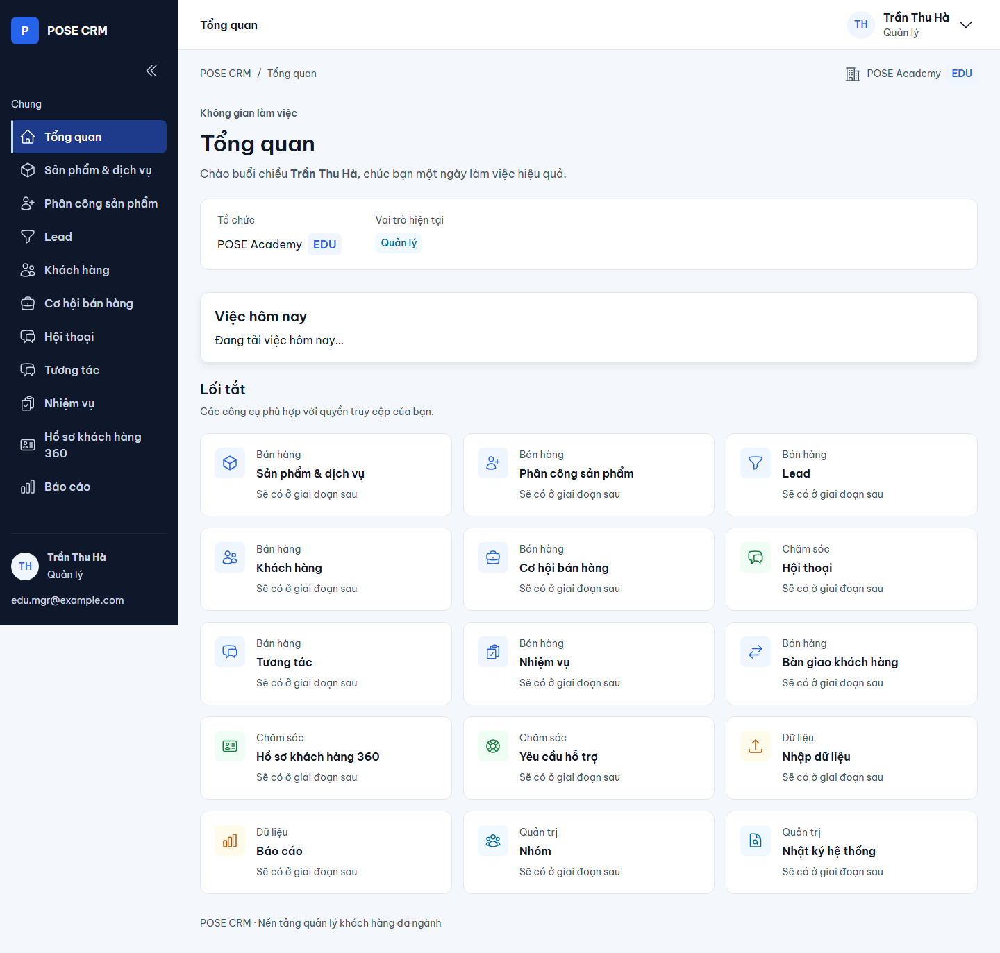
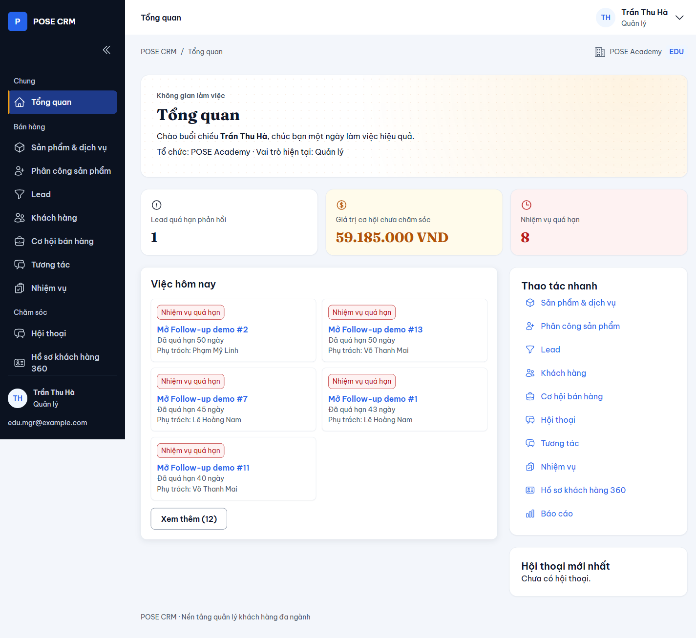
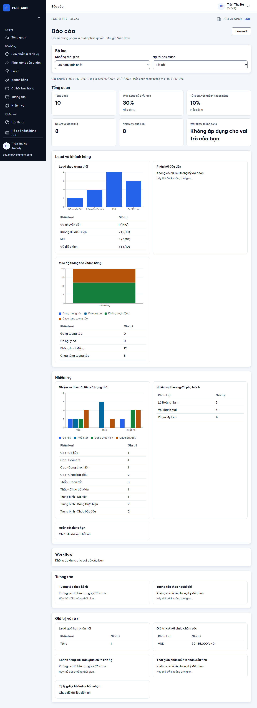
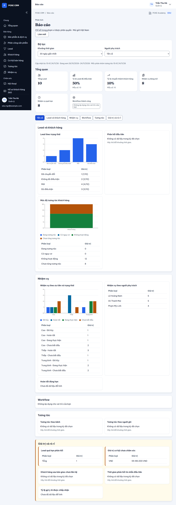
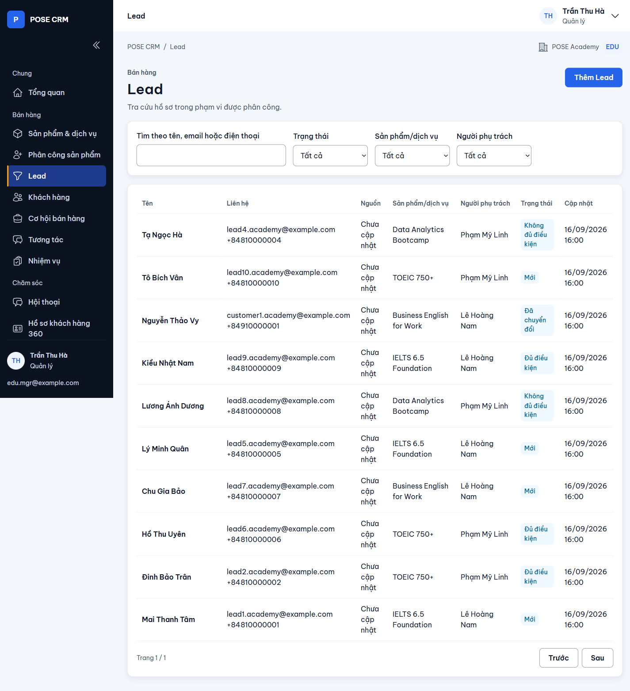
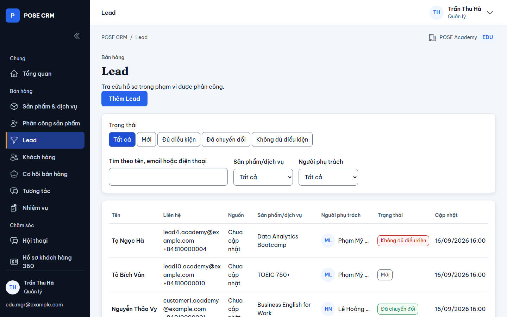

# CHƯƠNG 4. TRIỂN KHAI HỆ THỐNG

> Bản nháp ngày 23/11/2026 (Tài). Nguồn: mã nguồn nhánh `Tài` (commit `c92a772`), `readme.md`, `docs/huong-dan-chay-local.md`, `docs/api/*.md`, decision log. Mục đánh dấu **[Cập nhật sau AI-08]** điền khi Messenger hoàn tất (hạn 03/12). Ảnh chụp màn hình bổ sung khi chuyển docx, không chụp token, mật khẩu hay URL tunnel.

## 4.1. Môi trường và công nghệ

| Thành phần | Công nghệ | Ghi chú |
|---|---|---|
| Frontend | Next.js 16.4.6, React 19, TypeScript, Tailwind CSS, TanStack Query, Recharts | Lớp BFF của Next.js chuyển tiếp API và giữ token trong cookie HttpOnly |
| Backend | Java (JDK 25, target 21), Spring Boot 3.5, Spring Security, Flyway | Maven đa module: `automation/workflow-core` và `backend` |
| Cơ sở dữ liệu | PostgreSQL 18 | Supabase dùng chung; cụm cô lập `127.0.0.1:54329` cho kiểm thử, `54330` cho phát triển |
| AI | AI Gateway với Gemini, Claude và nhà cung cấp giả lập | Chọn bằng biến `POSE_AI_PROVIDER`, khóa chỉ trong biến môi trường |
| Kênh | Telegram Bot API, Zalo mô phỏng, Messenger Platform **[Cập nhật sau AI-08]** | Tunnel HTTPS (cloudflared) khi chạy kênh thật ở máy local |
| Kiểm thử | JUnit 5, H2, PostgreSQL cô lập, Vitest, Playwright | Chi tiết ở Chương 5 |

*Bảng 4.1. Công nghệ sử dụng*

Môi trường phát triển được dựng bằng một lệnh `scripts/dev.ps1`: khởi động PostgreSQL cục bộ, build backend khi mã nguồn thay đổi, chạy frontend và bật AI giả lập. Backend dừng ngay khi thiếu `POSE_DATABASE_URL` để tránh kết nối nhầm cơ sở dữ liệu (DEC-32, W17-06).

## 4.2. Tổ chức mã nguồn

Backend theo kiến trúc Modular Monolith, mỗi package là một module nghiệp vụ:

| Nhóm | Package |
|---|---|
| Nền tảng | `auth`, `security`, `identity`, `organization`, `team`, `audit`, `api` |
| Lõi CRM | `offering`, `salesassignment`, `lead`, `customer`, `opportunity`, `interaction`, `task`, `customer360`, `dashboard`, `crm`, `workflow` |
| CRM.AI | `channel`, `conversation`, `ai`, `copilot` |

*Bảng 4.2. Các module backend*

Frontend dùng App Router của Next.js: trang đăng nhập `/dang-nhap` và nhóm trang ứng dụng `(app)` gồm Tổng quan, Sản phẩm & dịch vụ, Lead, Khách hàng, Cơ hội bán hàng, Hội thoại, Tương tác, Nhiệm vụ, Hồ sơ khách hàng 360 và Báo cáo. Menu và thao tác hiển thị theo danh sách quyền trả về từ `/auth/me`, không theo tên vai trò.

## 4.3. Cơ sở dữ liệu và migration

Mọi thay đổi schema đi qua migration Flyway mới; migration đã áp lên môi trường dùng chung không được sửa lại.

| Phiên bản | Nội dung |
|---|---|
| V1 | Baseline từ gói dữ liệu V2 đa ngành của nhóm dữ liệu |
| V2–V4 | Phiên đăng nhập và refresh token; mã tổ chức đăng nhập; mã demo sáu tổ chức |
| V5–V8 | Phạm vi Offering theo nhóm; quyền quản lý phân công; actor hệ thống cho audit |
| V9 | Trường hồ sơ Customer/Lead |
| V10 | Cơ hội nhiều dòng Offering và các trường chốt (DEC-12) |
| V11 | Lõi Interaction, Task và audit |
| V12 | AI Gateway: `ai_invocations`, `ai_suggestions` |
| V13–V14 | Kênh hội thoại: `channel_accounts`, `conversations`, `conversation_messages`; người nhận mặc định theo tài khoản kênh |
| V15 | Tín hiệu khách hàng: `customer_signals`, `customer_signal_extractions` |
| V16 | (Java) mở rộng đối tượng gợi ý AI cho hội thoại |
| V17 | `ai_invocations.error_detail` cho dấu hiệu đầu ra không an toàn (DEC-27) |
| V18 | Mã lý do cho mọi đầu ra AI bị loại (DEC-35) |

*Bảng 4.3. Các migration*

## 4.4. Xác thực và phân quyền

- Đăng nhập bằng mã tổ chức, email và mật khẩu. Thông báo lỗi dùng chung, không tiết lộ tài khoản đã khóa hay sự tồn tại của tổ chức.
- Access token ngắn hạn và refresh token xoay vòng; mỗi phiên chỉ có một yêu cầu làm mới đang chạy; đăng xuất xóa dữ liệu phiên và bộ nhớ đệm của người dùng.
- Mỗi API kiểm tra theo thứ tự tổ chức → quyền → phạm vi nhóm → phạm vi bản ghi. Quyền được làm mới theo từng yêu cầu nên thu hồi quyền có hiệu lực ngay ở yêu cầu kế tiếp.
- Thao tác ghi khóa bản ghi tổ chức để tuần tự hóa thay đổi cùng tổ chức. Trên PostgreSQL dùng `FOR NO KEY UPDATE` thay cho `FOR UPDATE`, nên webhook chèn tin nhắn song song không còn gây deadlock với thao tác trả lời hoặc chuyển Lead (DEC-32, W17-04).

## 4.5. Lõi CRM

- **Offering và phân công:** Offering có thuộc tính mở rộng theo ngành; phân công có thời gian hiệu lực và lịch sử; thu hồi bị chặn khi còn cơ hội mở liên quan.
- **Lead, Customer, Cơ hội:** chuyển Lead thành Customer trong một giao dịch, chuyển kèm hội thoại và tín hiệu (DEC-30). Cơ hội 1–50 dòng, giá trị tính bằng BigDecimal, giai đoạn chỉ đi tiến; danh sách cơ hội nạp dòng sản phẩm bằng một truy vấn gộp (DEC-32, W17-01).
- **Customer 360:** tổng hợp định danh, người phụ trách, cơ hội, tương tác, nhiệm vụ, hội thoại và tín hiệu theo phạm vi người xem; nhân viên dữ liệu chỉ thấy metadata và số đếm.
- **Workflow:** module `workflow-core` dùng outbox, khóa idempotency và thử lại. Sự kiện `LEAD_QUALIFIED` tạo nhiệm vụ theo dõi; `MESSAGE_RECEIVED` tạo nhiệm vụ "Phản hồi đầu tiên" với actor hệ thống.
- **Dashboard:** 16 KPI nhóm A–D và nhóm E — Giá trị và rò rỉ: E01 lead quá hạn phản hồi, E02 giá trị cơ hội không được chăm sóc, E03 khách sau bàn giao chưa liên hệ, E04 thời gian phản hồi tin đầu tiên theo kênh, E05 tỷ lệ gợi ý AI được duyệt. Danh sách "Việc hôm nay" sắp theo quy tắc và hiện lý do ưu tiên.

## 4.6. Kênh hội thoại và hộp thư

- **Adapter kênh:** mỗi kênh có webhook riêng. Telegram xác thực header `X-Telegram-Bot-Api-Secret-Token`; Zalo mô phỏng xác thực `X-POSE-Webhook-Secret`; Messenger xác thực chữ ký `X-Hub-Signature-256` **[Cập nhật sau AI-08]**. Secret không lưu trong cơ sở dữ liệu, tài khoản kênh chỉ lưu tên biến môi trường chứa secret.
- **Chống trùng:** tin nhắn được ghi bằng `ON CONFLICT` theo mã tin của nền tảng; gửi lại cùng tin trả `duplicate: true` và không tạo thêm bản ghi, Interaction hay sự kiện.
- **Hộp thư:** danh sách lọc theo trạng thái và "Được giao cho tôi"; trả lời trong phạm vi quyền; tạo Lead từ hội thoại với số điện thoại/email gợi ý từ tin nhắn nhưng phải bấm mới điền (DEC-29). Trả lời Telegram gửi qua Bot API và lưu trạng thái `SENT`.
- **Kết quả kênh thật:** ngày 20/11/2026, bot Telegram thật nhận 3 tin từ điện thoại, nhân viên trả lời từ CRM và tin đến được điện thoại; worker tạo nhiệm vụ phản hồi đầu tiên và Interaction được ghi (evidence `docs/testing/telegram-real-e2e-2026-11-20.md`).

## 4.7. AI Gateway và quản trị AI

Mọi lời gọi mô hình đi qua `AiGateway`:

1. **Kiểm tra quyền và bật/tắt:** AI tắt mặc định; mỗi use case yêu cầu quyền riêng và phạm vi dữ liệu như thao tác thủ công.
2. **Dựng ngữ cảnh theo quyền:** chỉ đưa dữ liệu người gọi được xem; ghi chú `SALES_ONLY` không vào ngữ cảnh của nhân viên chăm sóc.
3. **Che dữ liệu:** số điện thoại, email, giấy tờ định danh được thay bằng mã như `[PHONE_1]` trước khi gửi.
4. **Chống prompt injection:** dữ liệu khách đặt trong khối `pose_untrusted_data`, vô hiệu hóa ký tự và tiền tố vai trò (DEC-27).
5. **Giới hạn chi phí:** hạn mức theo tổ chức; vượt hạn mức trả trạng thái chặn, không gọi mô hình.
6. **Kiểm tra đầu ra:** loại kết quả có URL lạ, UUID ngoài ngữ cảnh, đoạn trích chỉ dẫn hệ thống, thông tin liên hệ, token che, sai cấu trúc hoặc không có nguồn hợp lệ. Kết quả bị loại ghi `INVALID_OUTPUT` kèm mã lý do, không lưu nội dung (DEC-35).
7. **Nhật ký:** mỗi lần gọi ghi mô hình, phiên bản prompt, số token, chi phí ước tính, độ trễ, trạng thái; gợi ý chỉ người tạo xem và duyệt.

Ba nhà cung cấp cài đặt cùng giao diện: giả lập (dùng cho kiểm thử và demo dự phòng, trích tín hiệu theo từ khóa cố định — DEC-31), Gemini (mặc định cho chạy thật, DEC-22) và Claude (dự phòng).

## 4.8. Copilot và tín hiệu khách hàng

- **Tóm tắt Customer 360 và hồ sơ bàn giao:** mỗi ý có chip nguồn trỏ về Interaction, tin nhắn hoặc cơ hội; ý thiếu nguồn bị lọc; phần chưa có dữ liệu ghi "Chưa có dữ liệu". Đổi người phụ trách chuyển cơ hội mở và nhiệm vụ chưa xong sang người mới trong cùng giao dịch (DEC-20).
- **Bản nháp trả lời:** dùng tối đa 10 tin gần nhất; "Dùng bản nháp" chỉ điền vào ô trả lời, người dùng tự bấm gửi. Khi AI tắt, khối Copilot ẩn; khi AI lỗi, giao diện hiện "Chưa có gợi ý." kèm lý do và nút Thử lại, CRM vẫn dùng bình thường.
- **Tín hiệu khách hàng:** trích ý định (ASK_PRICE, ASK_INFO, BOOKING, PURCHASE_READY, COMPLAINT, SUPPORT, OTHER) và cảm xúc (POSITIVE, NEUTRAL, NEGATIVE) kèm câu trích dẫn; nhân viên chấp nhận, sửa, từ chối hoặc tự thêm tín hiệu. Không tạo tín hiệu trùng cho cùng tin. Job trích tự động riêng cho tin đến đã gắn hồ sơ, tắt mặc định (DEC-24).

## 4.9. Giao diện không gian làm việc (UI-01)

Ngày 24–25/11/2026 nhóm cải tổ giao diện vùng `/app/*` để phân cấp thông tin rõ hơn và đồng bộ thương hiệu với trang giới thiệu (DEC-38). Phần cải tổ chỉ đổi giao diện: không đổi API, cơ sở dữ liệu hay quyền; không thêm thư viện. Trang giới thiệu và trang đăng nhập giữ nguyên.

**Hệ thiết kế.** Token mới trong `frontend/src/styles/tokens.css`: sidebar navy `#0b1220` cùng điểm nhấn amber cho số liệu rò rỉ giá trị, hai mức bóng, bo góc cho panel và font hiển thị Fraunces chỉ dùng cho tiêu đề trang và số liệu lớn. Năm thành phần dùng chung: `PageHeader`, `StatCard`, `StatusPill`, `SegmentedTabs`, `Avatar`. Trạng thái luôn có chữ, không chỉ dựa vào màu.

**Khung ứng dụng.** Sidebar hiển thị theo nhóm điều hướng (Chung, Bán hàng, Chăm sóc, Dữ liệu) và vẫn lọc theo cả quyền lẫn vai trò đã cấu hình (DEC-11, DEC-12, DEC-15): Data Staff không thấy Lead, Khách hàng, Cơ hội dù có quyền đọc.

**Tổng quan.** Khối chào, hàng thẻ số liệu lấy từ API KPI hiện có (E01 lead quá hạn phản hồi, E02 giá trị cơ hội chưa chăm sóc, B02 nhiệm vụ quá hạn, E04 thời gian phản hồi tin đầu tiên), danh sách "Việc hôm nay" mặc định hiện 5 mục ưu tiên, cột phải gồm thao tác nhanh và hội thoại mới nhất. Chỉ số không áp dụng hoặc không có dữ liệu thì ẩn thẻ, không hiện số 0 giả.

**Báo cáo.** Tab nhóm chỉ số (chỉ hiện nhóm người xem được), nhóm "Giá trị và rò rỉ" nổi bật bằng màu amber. Đối chiếu chuỗi số trên 19 thẻ và panel của tài khoản Manager EDU trước và sau cải tổ: không có chênh lệch.

**Trang danh sách.** Tiêu đề thống nhất, bộ lọc trạng thái dạng nhóm nút khi có tối đa sáu lựa chọn, nhãn trạng thái có màu, avatar người phụ trách và bảng vừa khung 1440 px mà không cuộn ngang trong bảng.

*Hình 4.1. Tổng quan trước (trái, `ui01-tong-quan-truoc.png`) và sau (phải, `ui01-tong-quan-sau.png`) cải tổ.*

*Hình 4.2. Trang Báo cáo sau UI-01a–b nhưng trước UI-01c (`ui01-bao-cao-truoc.png`) và sau UI-01c (`ui01-bao-cao-sau.png`).*

*Hình 4.3. Trang Lead sau UI-01a–c nhưng trước UI-01d (`ui01-lead-truoc.png`) và sau UI-01d (`ui01-lead-sau.png`). Ảnh cho thấy lỗi bảng bị cắt cột Trạng thái đã được sửa.*

**Kiểm chứng.** Typecheck, lint và build đạt; Vitest 402/402 sau khi gộp nhánh; E2E mặc định 38/38. Kiểm tra tự động ở 375 px không thấy cuộn ngang trang. Chưa kiểm tay hành trình phím Tab, zoom 200% và trình đọc màn hình, nên báo cáo không khẳng định đạt toàn bộ WCAG 2.2 AA. Ảnh dùng dữ liệu demo, không chứa mật khẩu hay token. Evidence: `docs/testing/ui-01ab-2026-11-24.md`, `ui-01c-2026-11-24.md`, `ui-01d-2026-11-24.md`.

## 4.10. Giới hạn đã biết

- Danh sách tín hiệu và một số danh sách chọn chưa phân trang; chuyển KLTN (DEC-36).
- Gửi trả lời đồng bộ: nếu nền tảng đã gửi nhưng giao dịch cơ sở dữ liệu lỗi thì lần thử lại có thể gửi lặp; outbox cho chiều gửi chuyển KLTN (DEC-32, W17-03).
- Hội thoại chưa lưu tên người gửi, nhân viên nhập tên khi tạo Lead.
- Mô hình Gemini miễn phí có lúc quá tải hoặc trả đầu ra không đạt quy tắc an toàn (Chương 5); demo dùng AI giả lập làm phương án dự phòng.
- Messenger chạy ở chế độ phát triển, chỉ tài khoản có vai trò trong App nhắn được **[Cập nhật sau AI-08]**.
