# W11 — Tích hợp vertical slice: assignment → customer → task → Customer 360

Ngày 05/11/2026 · Owner: Huỳnh Minh Tài · Checkout `D:\POSE`, nhánh `Tài`, nền `373c83a`. Phạm vi thực hiện: mục **[Tài] FE** (nối luồng giao diện assignment → customer → task → Customer 360 và sửa lỗi tích hợp phía UI). Không sửa backend, không thêm migration, không thêm package; dùng skill `frontend-ui-engineering`.

## 1. Sơ đồ luồng theo bước

```mermaid
flowchart TD
  A["1. Manager mở /app/phan-cong"] --> B["Tạo phân công CURRENT cho cặp (Offering, Sales) chưa có phân công hiệu lực"]
  B --> C["2. Sales mở /app/san-pham -> /app/san-pham/{offeringId}"]
  C --> D["G3: Bấm 'Tạo Lead cho sản phẩm này' -> /app/lead/them?offeringId={offeringId}"]
  D --> E["CrmForm chọn sẵn Offering hợp lệ -> Tạo Lead (NEW)"]
  E --> F["Trang chi tiết Lead /app/lead/{leadId}: Xác nhận đủ điều kiện (QUALIFIED)"]
  F --> G["Chuyển thành khách hàng -> /app/khach-hang/{customerId} + invalidate customer360Key"]
  G --> H["3. G1: Từ CrmDetail bấm 'Thêm tương tác' -> /app/tuong-tac/them?customerId={customerId}"]
  H --> I["InteractionForm + SubjectPicker chọn sẵn Customer -> Lưu tương tác -> /app/tuong-tac/{interactionId}"]
  I --> J["G2: Từ InteractionDetail bấm link tên Customer quay lại /app/khach-hang/{customerId}"]
  J --> K["G1: Từ CrmDetail bấm 'Thêm nhiệm vụ' -> /app/nhiem-vu/them?customerId={customerId}"]
  K --> L["TaskForm + SubjectPicker chọn sẵn Customer -> Lưu nhiệm vụ -> /app/nhiem-vu/{taskId}"]
  L --> M["4. G2: Từ TaskDetail bấm 'Xem hồ sơ 360' -> /app/khach-hang-360/{customerId}"]
  M --> N["Sales & Manager thấy đủ Lead đã chuyển (1), Tương tác (1), Nhiệm vụ (1) ngay nhờ invalidate customer360Key"]
```

## 2. Các điểm nối giao diện đã triển khai (G1–G3 & Cache)

| Hạng mục | Thay đổi trên Frontend | Quy tắc quyền / Ràng buộc |
|---|---|---|
| **G1 — Nút tạo từ `CrmDetail` & chọn sẵn ở `InteractionForm` / `TaskForm`** | Thêm link `"Thêm tương tác"` (`/app/tuong-tac/them?customerId=…` hoặc `leadId=…`) và `"Thêm nhiệm vụ"` (`/app/nhiem-vu/them?customerId=…` hoặc `leadId=…`) trên `CrmDetail`. `InteractionForm` và `TaskForm` đọc query string trong `useEffect`, kiểm định dạng UUID qua `parseInitialWorkSubject`, nạp bản ghi lẻ qua `getCustomer`/`getLead` nếu đối tượng không nằm ở trang đầu của `SubjectPicker`. | Chỉ hiện nút khi `canCreateInteraction(user)` / `canCreateTask(user)` và hồ sơ không phải Lead đã đóng (`CONVERTED` hoặc `DISQUALIFIED` theo DEC-14). Nếu UUID sai, truyền đồng thời cả `customerId` và `leadId`, ngoài scope (403/404) hoặc Lead đã đóng: không gọi API với ID sai, xóa chọn sẵn và hiện `Alert` rõ ràng để người dùng chọn lại. |
| **G2 — Link đối tượng & `"Xem hồ sơ 360"` ở `InteractionDetail` / `TaskDetail`** | Cập nhật `WorkSubject` và `WorkOpportunity` trong `WorkReferences.tsx`; thêm nút `"Xem hồ sơ 360"` (`/app/khach-hang-360/{customerId}`) trên header của `InteractionDetail` và `TaskDetail` khi bản ghi gắn với Customer. | Link sang `/app/khach-hang/{id}`, `/app/lead/{id}`, `/app/co-hoi/{id}` chỉ hiển thị khi người dùng có permission đọc trang đích **và** không mang role `DATA_STAFF` (đồng bộ quy tắc W07). Nút `"Xem hồ sơ 360"` hiển thị khi có `customer_360.read` (bao gồm cả Data Staff). |
| **G3 — Lối vào `"Tạo Lead cho sản phẩm này"` từ `OfferingDetail`** | Thêm link `"Tạo Lead cho sản phẩm này"` (`/app/lead/them?offeringId=…`) ở `OfferingDetail`. Trong `CrmForm` (tạo mới Lead), sau khi tải danh sách Offering trong scope, kiểm `offeringId` từ URL: nếu nằm trong danh sách được chọn thì gán sẵn vào `values.offeringId` và `initial.offeringId` (không làm bẩn trạng thái `dirty`); nếu không khả dụng hoặc ngoài scope thì bỏ qua và hiện `Alert` giải thích. | Nút ở `OfferingDetail` chỉ hiện khi `offering.active === true` và `canCreateCrm(user, "lead")` (`lead.write` + `offering.read`/`offering.manage` + role `MANAGER`/`SALES_REP`). |
| **Bước 4 — Làm mới cache Customer 360 (`customer360Key`)** | Thêm hàm `invalidateCustomer360(cache, user, customerId)` trong `src/lib/customer360.ts` và gọi trong `onSuccess` của các mutation tạo/sửa/chuyển trạng thái tại `CrmForm`, `CrmDetail`, `ConvertLeadDialog`, `InteractionForm`, `TaskForm`, `TaskDetail`, `OpportunityForm`, `OpportunityDetail`. | Đảm bảo khi điều hướng quay lại `/app/khach-hang-360/{customerId}` trong cùng phiên, số đếm và danh sách trên hồ sơ 360 được tải mới ngay lập tức. |

## 3. Bảng kết quả theo vai trò

Kết quả tổng hợp từ bộ test đơn vị/tích hợp (`Vitest + RTL`) và bộ E2E trình duyệt (`Playwright Chromium` trên bản sao database cô lập):

| Vai trò (EDU) | Phân công & Offering (G3) | Lead & Chuyển thành Customer | Tương tác & Nhiệm vụ từ hồ sơ (G1, G2) | Hồ sơ Customer 360 (G2 & Cache) | Kết quả |
|---|---|---|---|---|---|
| **Manager (`edu.mgr`)** | Tạo phân công `CURRENT` trên `/app/phan-cong`; thấy nút `"Tạo Lead cho sản phẩm này"` trên Offering đang hoạt động | Tạo Lead, chọn Sales phụ trách, qualify và chuyển thành Customer | Thấy nút `"Thêm tương tác"`, `"Thêm nhiệm vụ"` trên Customer và Lead mở; ẩn trên Lead `CONVERTED`/`DISQUALIFIED` | Xem hồ sơ 360 từ `CrmDetail`, `InteractionDetail`, `TaskDetail`; thấy đủ Lead (1), Tương tác (1), Nhiệm vụ (1) | **Đạt** |
| **Sales (`edu.s01`, `edu.s02`)** | Chỉ thấy Offering khi có phân công `CURRENT`; bấm `"Tạo Lead cho sản phẩm này"` mở form `/app/lead/them?offeringId=…` chọn sẵn Offering | Tạo Lead trong scope, xác nhận `QUALIFIED` và trực tiếp chuyển thành Customer mới | Từ trang Customer bấm `"Thêm tương tác"` và `"Thêm nhiệm vụ"` đều chọn sẵn khách hàng; từ chi tiết Tương tác bấm tên Customer quay về hồ sơ khách hàng | Từ chi tiết Nhiệm vụ bấm `"Xem hồ sơ 360"` mở `/app/khach-hang-360/{id}`, số liệu cập nhật ngay sau thao tác | **Đạt** |
| **Customer Care (`edu.care`)** | Không có quyền đọc Offering/Lead | Chỉ đọc Customer trong scope; không có nút tạo Lead hoặc Opportunity | Thấy nút `"Thêm tương tác"` (`CARE_VISIBLE`) và `"Thêm nhiệm vụ"` trên Customer trong scope; từ chi tiết việc làm mở được Customer và 360 | Xem hồ sơ 360 thấy phần trong quyền, Cơ hội hiển thị `restricted`, Tương tác `SALES_ONLY` ẩn nội dung | **Đạt** |
| **Data Staff (`edu.data`)** | Không có quyền truy cập Offering/Phân công | Không truy cập danh sách/chi tiết Customer hoặc Lead (`/app/khach-hang/*`, `/app/lead/*`) | Ở `InteractionDetail` / `TaskDetail`, tên Customer/Lead/Opportunity chỉ hiện dạng chữ (không render link gây lỗi quyền), nhưng vẫn có nút `"Xem hồ sơ 360"` | Mở hồ sơ 360 qua đối soát hoặc từ nút `"Xem hồ sơ 360"`, chỉ thấy metadata và số đếm theo DEC-15 D2 | **Đạt** |
| **Admin (`edu.admin`)** | Quản lý danh mục và phân công | Chỉ đọc Lead/Customer/Opportunity; không có nút tạo/sửa CRM, Interaction hay Task | Xem chi tiết Interaction có link sang Customer/Lead và `"Xem hồ sơ 360"`; không mở được route `/them` của Interaction/Task | Xem hồ sơ 360 và bảng đối soát toàn tổ chức | **Đạt** |

## 4. FINDING (Tách lỗi FE đã sửa và API cho Thắng)

### 4.1 FINDING phía FE (đã sửa và có test trong W11)

- **F-W11-FE-01 — `WorkSubject` và `WorkOpportunity` hiển thị link chết cho actor có role `DATA_STAFF` (Đã sửa ở commit `c65153d`):**
  - *Hiện tượng:* Trong dữ liệu phân quyền V2 (`role_permissions.csv`), role `DATA_STAFF` có các permission `customer.read`, `lead.read`, `opportunity.read`, nhưng theo DEC-11/12/15 và `canReadCrm` (`src/lib/crm.ts`), `DATA_STAFF` không có scope đọc màn hình danh sách/chi tiết Customer, Lead, Opportunity. Trước W11, `WorkSubject` chỉ kiểm `user.permissions.includes("customer.read")` nên hiển thị link `/app/khach-hang/{id}` cho Data Staff; khi bấm vào sẽ rơi vào màn hình không có quyền truy cập.
  - *Khắc phục:* Kiểm thêm `!user.roles.includes("DATA_STAFF")` trong `WorkSubject` và `WorkOpportunity` (giống quy tắc ở `Customer360Profile`), đồng thời bổ sung nút `"Xem hồ sơ 360"` ở `InteractionDetail` và `TaskDetail` khi có `customer_360.read`. Đã khóa bằng unit test trong `tests/work-ui.test.tsx`.
- **F-W11-FE-02 — Đọc query string trực tiếp trong `useState` khởi tạo của `InteractionForm` / `TaskForm` làm mất giá trị chọn sẵn khi hydration trên bản build production (Đã sửa ở commit `b33f303`):**
  - *Hiện tượng:* Trên Next.js App Router production build (`next start`), `/app/tuong-tac/them` và `/app/nhiem-vu/them` là trang tĩnh (`○`). Khi SSR/prerender, `window` chưa tồn tại nên `subjectId` khởi tạo là `""`. Khi điều hướng client-side tới `/app/tuong-tac/them?customerId=…`, việc đọc `window.location.search` ngay trong `useState` khởi tạo khiến giá trị `<select id="work-subject-picker">` bị rơi về `""` sau bước hydration/render danh sách.
  - *Khắc phục:* Chuyển việc đọc `parseInitialWorkSubject(window.location.search)` vào `useEffect` sau mount (đồng nhất với cách `OpportunityForm` đọc `customerId` và `CrmForm` đọc `offeringId`). Sau khi sửa, cả Vitest và 2 lượt E2E production build đều chọn sẵn đúng đối tượng.

### 4.2 FINDING phía API / Backend cho Thắng

- **Không phát sinh lỗi API/dữ liệu backend mới trong luồng vertical slice W11:**
  - Các API trong luồng (`POST /api/v1/sales-assignments`, `GET /api/v1/offerings`, `POST /api/v1/leads`, `POST /api/v1/leads/{id}/qualify`, `POST /api/v1/leads/{id}/convert`, `POST /api/v1/interactions`, `POST /api/v1/tasks`, `GET /api/v1/customers/{id}/360`) hoạt động đúng contract và đồng bộ ngay với view `v_customer_360_summary`.
  - Quyền chuyển Lead thành Customer của `SALES_REP` (`edu.s01`, `edu.s02`) hoạt động đúng khi có phân công `CURRENT` trên Offering của Lead (có đủ `lead.write` và `customer.write`), không bị chặn nên không cần chuyển sang Manager thực hiện thay.
  - Các ghi nhận lịch sử từ W06/W07/W10 (như Data Staff không có nguồn chọn đối tượng ở bộ lọc CRM hoặc lệch tài liệu `roles-authorization-v1.md` dòng Opportunity của Care theo DEC-12 F4) giữ nguyên theo quyết định đã chốt, không mở rộng trong card này.

## 5. Kết quả kiểm tra cuối

Thực hiện tại `D:\POSE\frontend` và `D:\POSE`:

| Lệnh kiểm tra | Kết quả |
|---|---|
| `npx vitest run` | **25/25 file đạt, 288/288 test đạt** (tăng 8 test mới cho G1–G3 và cache 360) |
| `npm run typecheck` | **Đạt** (`tsc --noEmit` 0 lỗi) |
| `npm run lint` | **Đạt** (`eslint . --max-warnings=0` 0 lỗi, 0 cảnh báo) |
| `npm run build` | **Đạt** (Next.js 16.4.3 production build hoàn tất; chỉ có cảnh báo `SITE_URL` mặc định local) |
| `scripts/e2e-env.ps1` — Lượt 1 | **18/18 test đạt** (25,4 giây), gồm kịch bản mới `vertical-slice.spec.ts` |
| `scripts/e2e-env.ps1` — Lượt 2 | **18/18 test đạt** (26,0 giây) |
| Kiểm cổng sau E2E | Cả 5 cổng `8080`, `8081`, `3010`, `3011`, `54329` đã dừng; bản sao DB và thư mục `.auth` tạm đã được dọn |

Không kết nối Supabase hoặc PostgreSQL cổng 5432; không in hoặc lưu mật khẩu/token trong log và evidence.

## 6. Giới hạn

- Phần `[Thắng] BE` (kiểm thử tích hợp backend bổ sung cho W11 nếu có) nằm ngoài phạm vi mục `[Tài] FE` và không thực hiện trong lượt này.
- Kiểm thử trình duyệt tự động chỉ chạy trên Chromium qua Playwright (`1280×800` và `375×812`); chưa kiểm thử thủ công với trình đọc màn hình (NVDA/VoiceOver) hoặc trên thiết bị di động vật lý.
